<p align="center">
  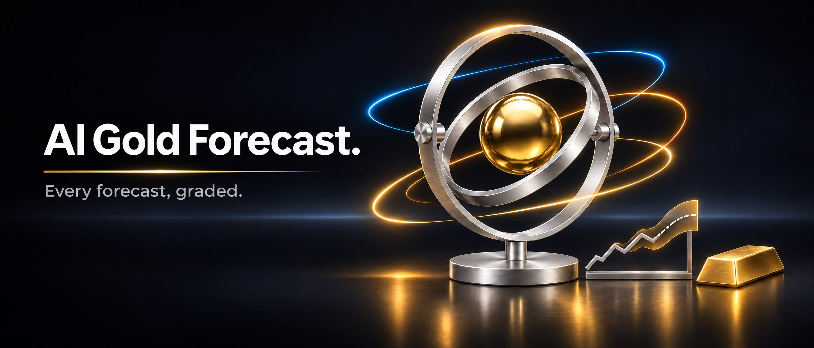
</p>

<h1 align="center">AI Gold Forecast</h1>

<p align="center">
  <b>Gold price forecasts that learn every day, and are graded against the simplest opponent: "the price will not change".</b><br>
  COMEX gold futures · next settlement, 1, 5 and 20 sessions ahead · a dozen candidate models, one champion · every forecast stored before its outcome
</p>

<p align="center">
  
  
  
  
  
  
  
  
  <a href="LICENSE"></a>
</p>

<p align="center">
  <a href="#what-it-is">What it is</a> ·
  <a href="#why-it-is-different">Why it is different</a> ·
  <a href="#how-it-learns-every-day">How it learns</a> ·
  <a href="#honest-results-so-far">Results</a> ·
  <a href="#how-it-works">How it works</a> ·
  <a href="#run-it-yourself">Run it yourself</a> ·
  <a href="#the-app">The app</a> ·
  <a href="#development">Development</a>
</p>

---

> [!IMPORTANT]
> **This is an ongoing project.** It is still being developed and will keep getting updates, so the models, the screens and the results on this page will change. The [commit history](https://github.com/Martysunshine/ai-gold-forecast/commits/main) shows what changed and when.

## What it is

AI Gold Forecast forecasts the price of COMEX gold futures: at the next settlement, and 1, 5 and 20 trading sessions ahead, each with a range.

Every day a background worker collects the new prices, checks them, scores the forecasts whose day has closed, re-tests about a dozen candidate models and issues the next forecasts. Each forecast is written to a ledger before its outcome exists, and the ledger refuses edits and deletes. A new model takes over only when it has beaten both the current one and "the price stays put", on history and on its own live record.

So far nothing has beaten "the price stays put", and the app says so on every forecast.

<p align="center">
  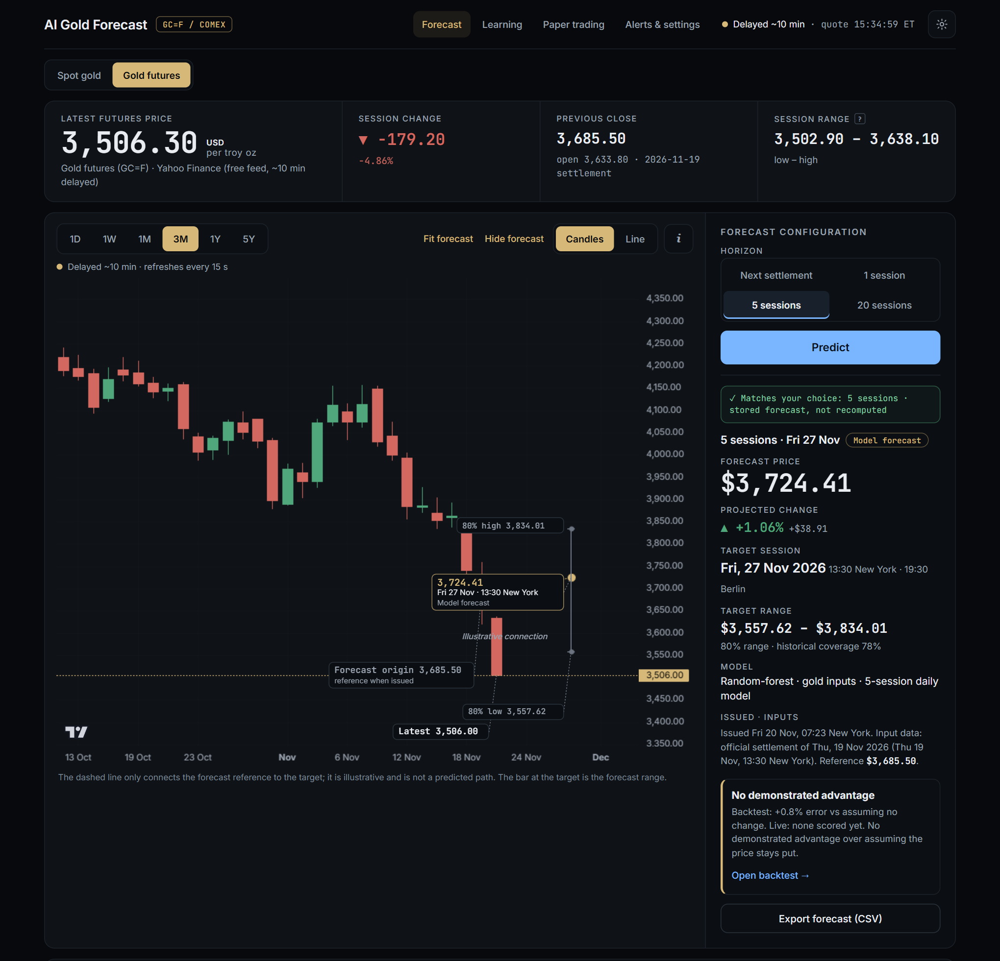
</p>

<sub>A 5-session forecast drawn on the chart: where it started, the target session, and the range there. The note at the bottom right is computed from the record, not written by hand.</sub>

> [!NOTE]
> This app forecasts. It places no orders and holds no account. The forecasts are model outputs, not trading signals.

## Why it is different

<table>
  <tr>
    <td width="50%" valign="top" align="center">
      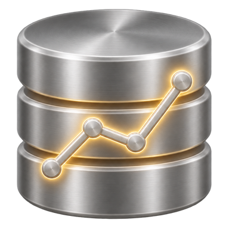<br>
      <b>Only real, completed sessions</b><br><br>
      <sub>Five years of COMEX gold futures (<code>GC=F</code>) daily closes. A session counts only once it has closed and its close agrees with the settlement-time price. Dates follow the exchange's own time zone. Wrong units, a stale feed or a changed data format block learning for the day and leave the working models alone.<br><br>
      <a href="backend/app/data.py">data.py</a> · <a href="backend/app/quality.py">quality.py</a> · <a href="backend/app/sessions.py">sessions.py</a></sub>
    </td>
    <td width="50%" valign="top" align="center">
      <br>
      <b>A dozen candidates, one champion</b><br><br>
      <sub>Ridge regression, gradient boosting and random forests, fed gold prices, market drivers (dollar, yields, stocks, volatility) or price patterns. One of them, the champion, makes the forecast; the others are scored in shadow on the same dates.<br><br>
      <a href="backend/app/learning.py">learning.py</a> · <a href="backend/app/model.py">model.py</a> · <a href="backend/app/registry.py">registry.py</a></sub>
    </td>
  </tr>
  <tr>
    <td width="50%" valign="top" align="center">
      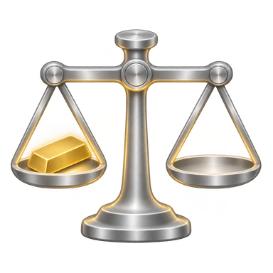<br>
      <b>Proof twice before a promotion</b><br><br>
      <sub>A challenger must beat the champion and the unchanged price by at least 2% on a walk-forward test of history, and again on at least 30 independent blocks of its own live forecasts. One promotion per horizon in 30 days at most; a champion that falls 5% behind the unchanged price is rolled back.<br><br>
      <a href="backend/app/learning.py">learning.py</a> · <a href="backend/app/ledger.py">ledger.py</a></sub>
    </td>
    <td width="50%" valign="top" align="center">
      <br>
      <b>A range, and how often it held</b><br><br>
      <sub>Every forecast comes with a range meant to hold 80% of the time, scaled by how much gold has been moving lately. Beside it the app prints how often that range really held: 84%, 73% and 53% for 1, 5 and 20 sessions on the latest test year.<br><br>
      <a href="docs/GUIDE.md">the guide</a></sub>
    </td>
  </tr>
</table>

## How it learns, every day

A background worker (`python -m app.worker run`) runs the loop on its own, with the browser and the web server closed:

| When | What |
|---|---|
| Every 5 minutes | When a session has closed (after 17:00 New York, once the daily close agrees with the 13:25 settlement-time price): check the data, re-evaluate every candidate and issue the next forecasts |
| 23:30 UTC every day | The full cycle: collect, validate, score matured forecasts, walk-forward-evaluate every candidate, decide, publish |
| On start | A catch-up cycle when the last successful learning run is more than 26 hours old |
| Every 30 minutes, hourly | Score newly matured forecasts; the next-settlement forecast |

The Learning page shows which model is in charge of each horizon, its record against the unchanged price, and how close its forecasts came to the prices that followed:

<p align="center">
  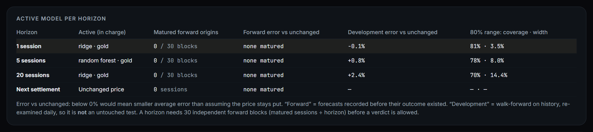
</p>

<p align="center">
  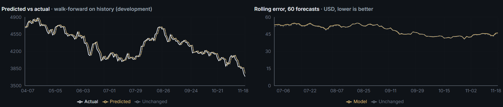
</p>

<sub>Left: each 1-session forecast against the price that followed, April to November 2026. Right: the average miss over the last 60 forecasts, in dollars, for the model and for "the price stays put". The two lines lie almost on top of each other, which is the honest picture: close, but not yet better.</sub>

More detail, including how a model gets promoted: [docs/GUIDE.md](docs/GUIDE.md#how-learning-works).

## Honest results so far

**No model has beaten "price unchanged" at any horizon yet.** That is the result, so it is near the top.

The test year is the latest year of prices, held out while the models were fitted. "Average miss" is the mean absolute error: the average distance between the forecast and the price that followed, in US dollars per troy ounce. Lower is better; **bold** marks the best. Prices through 19 Nov 2026.

| Horizon | Model picked | Test year | Avg miss: Ridge | Avg miss: Random Forest | Avg miss: price unchanged | Direction right | 80% range held |
| --- | --- | --- | ---: | ---: | ---: | ---: | ---: |
| 1 session | Ridge | 24 Nov 2025 to 18 Nov 2026, 248 forecasts | $58.30 | $58.71 | **$58.00** | 49% | 84% |
| 5 sessions | Random Forest | 19 Nov 2025 to 12 Nov 2026, 247 forecasts | $139.89 | $139.02 | **$137.50** | 52% | 73% |
| 20 sessions | Ridge | 3 Nov 2025 to 22 Oct 2026, 244 forecasts | $289.51 | $293.83 | **$273.46** | 45% | 53% |

What the table says:

- **The forecasts are close, but the baseline is closer.** At 1 session the model misses by $58.30 on average, the unchanged price by $58.00: 30 cents apart on a $58 miss.
- **Longer horizons are harder.** At 20 sessions the models looked better than the baseline on the validation year and worse on the test year. One year can flatter a model.
- **The ranges hold at 1 session and are too narrow beyond that.** The app prints the real figure beside every range for this reason.
- **The live record has just started.** Since 20 Nov 2026 every forecast is stored before its outcome. A verdict on live forecasts needs 30 independent blocks, so early January 2027 at the soonest for the 1-session horizon. The trading project below scores the 1-session call on a demo account: right on 1 of the first 4 days.
- **Daily gold is close to a random walk.** The value here is the grading: a loop that would find and promote real skill if a model had any, and says plainly when none has.

The numbers change as new prices arrive. The app always shows the current ones.

## How it works

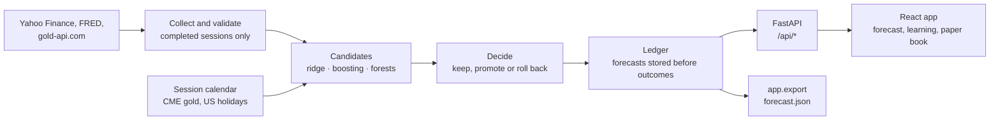

The app's Methodology tab explains a forecast in plain words, with the data, the split, the calendar and the range:

<p align="center">
  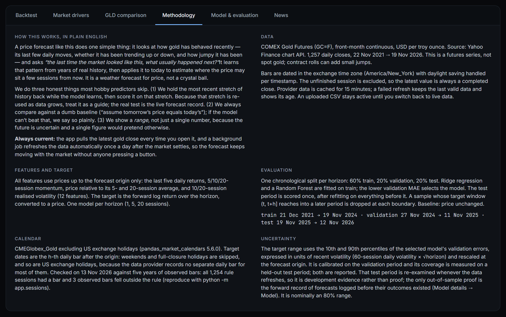
</p>

Choosing each horizon, forecasting it, opening the backtest, then the Learning page:

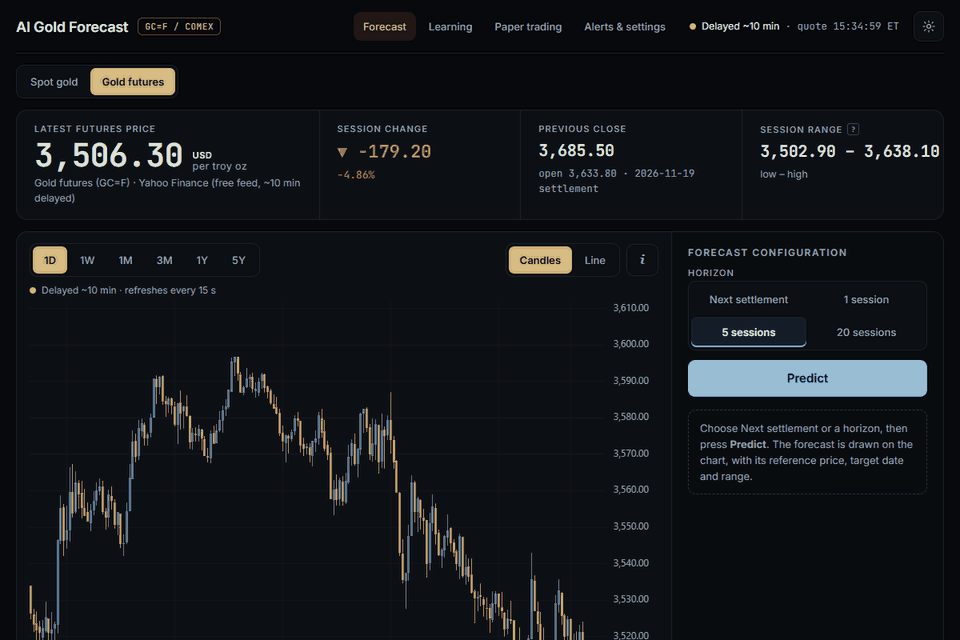

<table>
<tr>
<td width="68%" valign="top">
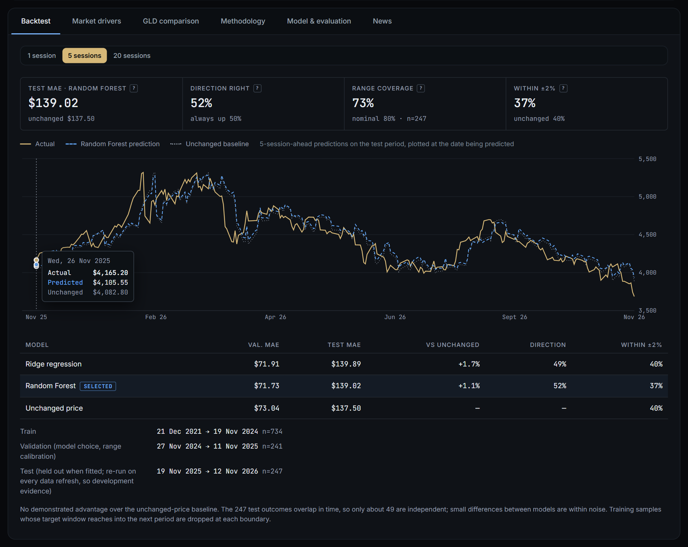
</td>
<td width="32%" valign="top">
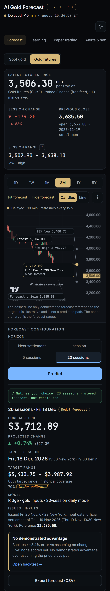
</td>
</tr>
<tr>
<td><sub>Backtest: every test forecast against the price that followed and against the baseline. On 26 Nov 2025 the 5-session forecast said $4,105.55; the price was $4,165.20.</sub></td>
<td><sub>On a phone, 390 px wide.</sub></td>
</tr>
</table>

The parts:

| Part | Where | What it does |
| --- | --- | --- |
| Data and checks | [`data.py`](backend/app/data.py), [`quality.py`](backend/app/quality.py), [`drivers.py`](backend/app/drivers.py) | Fetches, validates and caches gold prices and the market drivers |
| Calendar | [`sessions.py`](backend/app/sessions.py) | Decides which future dates are trading sessions |
| Features and models | [`features.py`](backend/app/features.py), [`feature_groups.py`](backend/app/feature_groups.py), [`model.py`](backend/app/model.py) | Inputs from past data only; the candidate models |
| Learning | [`learning.py`](backend/app/learning.py), [`registry.py`](backend/app/registry.py) | Walk-forward tests, champions, promotion and rollback |
| Ledger | [`ledger.py`](backend/app/ledger.py), [`db.py`](backend/app/db.py) | Forecasts stored before outcomes; outcomes written once |
| Worker | [`worker.py`](backend/app/worker.py) | The schedule above, with one worker at a time |
| Export | [`export.py`](backend/app/export.py) | The champion's forecasts as one JSON file |
| API and app | [`main.py`](backend/app/main.py), [`frontend/src/`](frontend/src) | FastAPI; React and TypeScript |
| Checks | [`backend/tests/`](backend/tests), [`e2e/`](e2e) | 277 backend tests and the browser checks |

## Run it yourself

You need Python 3.11 or newer, Node.js 20 or newer, and an internet connection for prices and headlines. No API key.

**Windows**

```bat
git clone https://github.com/Martysunshine/ai-gold-forecast.git
cd ai-gold-forecast
start.cmd
```

**macOS and Linux**

```bash
git clone https://github.com/Martysunshine/ai-gold-forecast.git
cd ai-gold-forecast
./start.sh
```

The app opens at **http://localhost:8742**. The first run creates `backend/.venv`, installs the pinned packages and builds the app, which takes about a minute. Later runs start at once.

The background worker, so the model keeps learning with the app closed:

```bash
cd backend
.venv\Scripts\python -m app.worker run        # Windows (keep the window open)
./scripts/worker.sh install                   # macOS: a launchd agent that starts at login
.venv\Scripts\python -m app.worker status     # what ran, when, and which model is in charge
.venv\Scripts\python -m app.worker cycles     # the daily-cycle record
```

Only one worker runs at a time (a lock); the web app starts its own only when no other worker is running.

| To | Windows | macOS and Linux |
| --- | --- | --- |
| Use another port | `start.cmd -Port 9000` | `PORT=9000 ./start.sh` |
| Work without the internet (cached data or a CSV only) | `set GOLD_OFFLINE=1` then `start.cmd` | `GOLD_OFFLINE=1 ./start.sh` |

Optional settings are listed in [`.env.example`](.env.example).

## The app

| Page | What it shows |
| --- | --- |
| **Forecast** | The latest price, a candle or line chart from one day to five years, and the forecast for the horizon you pick, drawn on the chart with its range. Under the chart: the backtest, the market drivers, the GLD comparison, the methodology, the model's record and recent headlines. |
| **Learning** | The worker's status and schedule, the model in charge of each horizon, forward and walk-forward records, predicted against actual, every candidate and its latest decision, data-quality findings and every training attempt. |
| **Paper trading** | A simulated book that follows the forecasts by fixed rules. Nothing is bought or sold. |
| **Alerts & settings** | Optional price-level alerts by SMS through n8n (simulation by default), the data sources and the background service. |

<details>
<summary><b>Data and market conventions</b></summary>

| Topic | Convention |
| --- | --- |
| **Instrument** | COMEX gold futures, front-month continuous (`GC=F`), US dollars per troy ounce. This is futures, not spot gold, so a change of contract can add a small jump. |
| **Providers** | Yahoo Finance for gold and market drivers, FRED for rates, gold-api.com for a spot check. The Yahoo endpoint is unofficial and may be rate-limited or change. |
| **Completed sessions** | A session counts once it has closed (after 17:00 New York) and its close agrees with the 13:25 settlement-time price. |
| **Time zone** | Bars are dated in `America/New_York`, converted per timestamp, so daylight saving is handled. |
| **Calendar** | A target is the h-th future session: CME Globex gold sessions minus US exchange holidays (`pandas_market_calendars`). |
| **Bad data** | Duplicates, out-of-order rows, wrong units, a stale feed and format changes are found and recorded, never deleted. The serious ones block learning for the day. |
| **News** | Google News RSS headlines with source links. Not a model input. |

</details>

<details>
<summary><b>Optional: the GLD comparison</b></summary>

Alpaca does not carry gold futures, so it is used for one read-only job: daily bars of the GLD fund, shown beside `GC=F`. GLD is a different instrument, priced per share, and never a model input. The app calls no order or account endpoint.

Copy `.env.example` to `.env`, set `ALPACA_API_KEY_ID` and `ALPACA_API_SECRET_KEY` (paper or market-data keys), and start the app again. Keys are read on the server only and never appear in the app or its responses. `.env` is ignored by git.

</details>

## The forecast as a file

```bash
cd backend
.venv\Scripts\python -m app.export --out forecast.json
```

Writes the champion forecast of each horizon from the ledger as one JSON document (schema `ai-gold-forecast.forecast/1`): the call, its range, the period it applies to (`valid_from` to `valid_until`, the end of the target day in New York), the model's walk-forward and live record, and a `learning` block saying when the model last learned. The export never fits a model and never contacts a provider, so every run returns the same call for a session. `evaluation.advantage` is `true` only while the champion is a model the loop promoted.

## Development

```bash
# backend            (Windows: backend\.venv\Scripts\uvicorn app.main:app --reload --port 8742, from backend\)
cd backend && .venv/bin/uvicorn app.main:app --reload --port 8742

# frontend: http://localhost:5183, passes /api on to port 8742
cd frontend && npm run dev
```

| Check | Windows | macOS and Linux |
| --- | --- | --- |
| Backend, 277 tests | in `backend\`: `.venv\Scripts\python -m pip install -r requirements-dev.txt` then `.venv\Scripts\python -m pytest -q` | `cd backend && .venv/bin/pip install -r requirements-dev.txt && .venv/bin/python -m pytest -q` |
| Types and build | `npm run build` in `frontend\` | `cd frontend && npm run build` |
| Browser checks (Chrome or Edge, the internet) | with the app running: `set URL=http://127.0.0.1:8742` then `node e2e\verify_pages.mjs` | `./e2e/run_pages.sh` and `./e2e/run_alerts.sh` (on a throwaway copy of the data) |
| Retake the README screenshots | `set LIVE=http://127.0.0.1:8742 && set OUT=docs\screenshots && node e2e\shots.mjs` | `LIVE=http://127.0.0.1:8742 OUT=docs/screenshots node e2e/shots.mjs` |

Packages are pinned in `backend/requirements.txt` and in the `package-lock.json` files. See [SECURITY.md](SECURITY.md) for reporting a problem.

## Relation to AI Stock Trader

This is a sister project of [AI Stock Trader](https://github.com/Martysunshine/ai-stock-trader), an automated trading system that has to prove an edge before it may touch real money. The two share a design and an attitude: results are published as they are.

They are separate programs and meet at one point: the trader's gold practice lane, which trades a gold CFD on a demo account, reads the file that `python -m app.export` writes.

- **One practice rule trades the forecast's direction.** Once a day, on the forecast's target day, it buys the gold CFD when the one-session forecast says up and sells when it says down, with a stop, a target and an exit before the day ends.
- **The other gold practice rule follows it.** Its entries against the day's forecast are refused, and it stakes twice as much when the forecast agrees.
- **Every forecast is scored.** The trader logs each one-session forecast and marks it right or wrong once the day has closed. That is a live score of the forecast on real fills.
- **This is practice, not proof.** `evaluation.advantage` is `false` at every horizon today. The demo trades show what the forecast is worth live; they are not evidence for trading real money, and nothing that could trade real money reads the forecast.

## Research notes

- One split in time is one draw from history. Another test year can give another verdict; that is why the loop re-tests every day and asks for a live record before it trusts a model.
- An experimental Fibonacci feature group was tested against the same models without it. It made no model reliably better and was rejected; its history is kept.
- Up-or-down classifiers were tried earlier. At 20 sessions they scored 75 to 78% on validation and 46 to 47% on test, because gold rose through the validation year. They were not adopted.

> [!WARNING]
> This is a research project, not financial advice. Nothing here claims or implies profitable trading. Market data comes from Yahoo Finance, FRED and gold-api.com and, optionally, Alpaca; headlines come from Google News. Each source has its own terms of use.

## Credits and licence

The banner and the emblems were generated with AI image tools (GPT Image through Higgsfield). The screenshots are of the app itself.

**Licence.** The work by Martin Matysek in this repository is released under the [MIT licence](LICENSE). Code written by other contributors remains theirs and is covered by that licence only where they have agreed to it. That includes the first commits in the history, and most of the learning version added in November 2026 (the forecast ledger, the daily worker and the promotion rules), which another contributor wrote; the work done on it here is mainly the Windows support, the export for other programs and this README. Third-party packages remain under their own licences.

Created by martin.matysek
