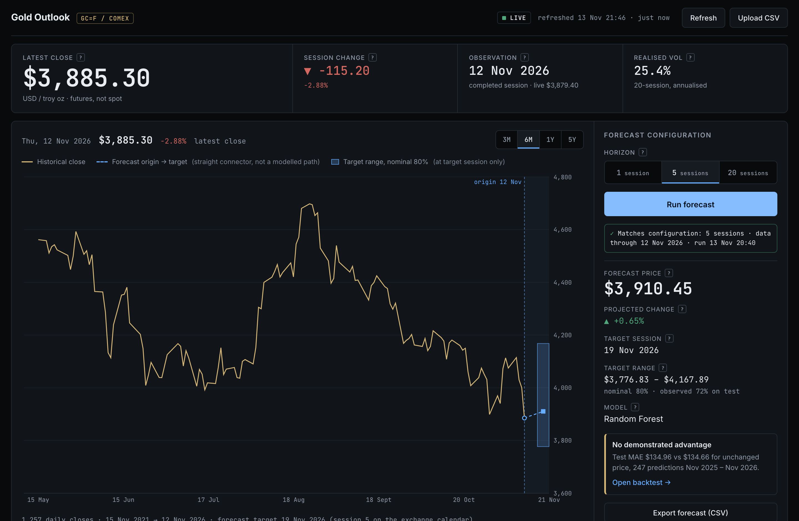
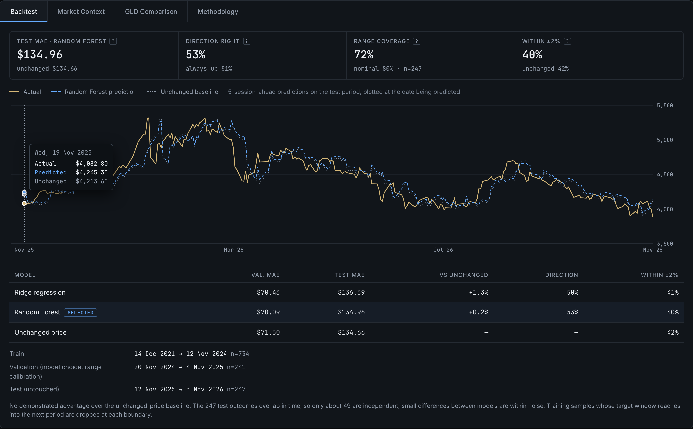
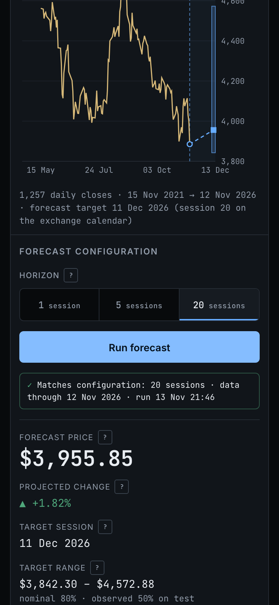
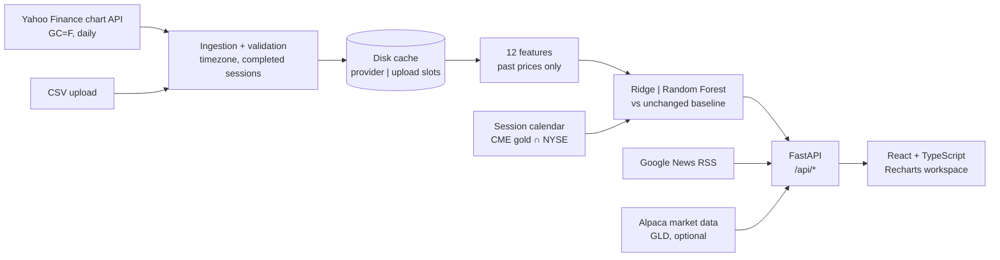

# GOLD OUTLOOK

### One metal. Three horizons. Show your work.

A gold futures forecasting workspace combining historical prices, machine-learning forecasts and transparent model evaluation.




**[Quick start](#quick-start) · [The terminal](#the-terminal) · [Under the hood](#under-the-hood) · [Results](#results-without-the-victory-lap) · [Development](#development)**

---

Most price-prediction demos show you a confident number. This one shows the number, the range around it, and a year of evidence about how much that number deserves to be trusted. It runs on COMEX gold futures (`GC=F`), forecasts 1, 5 or 20 trading sessions ahead, and grades every model against the toughest simple opponent in finance: *tomorrow's price is today's price.*

The baseline gets a seat at the table. On the latest data, it also gets the last word.

## The workflow

| | |
|---|---|
| **1. Explore the tape.** Five years of daily closes, viewable as 3M, 6M, 1Y or 5Y windows, with the latest completed session, its change and 20-session realised volatility. | **2. Pick a horizon.** 1, 5 or 20 sessions on the real exchange calendar, so "5 sessions" lands on an actual trading day, not five calendar days. |
| **3. Run the forecast.** A point estimate, a projected change, the target session and a nominal 80% range, with the range's *observed* coverage printed right beside it. | **4. Check the receipts.** The Backtest tab plots every held-out prediction against what actually happened, next to the unchanged-price baseline. |
| **5. Read the room.** Market Context collects recent gold headlines with sources. They are background only and never feed the model. | **Optional: GLD side by side.** With Alpaca keys, the GLD ETF is plotted against the futures. This view is for context only. |


<table>
<tr>
<td width="68%"></td>
<td width="32%"></td>
</tr>
<tr>
<td><sub>Backtest: every held-out prediction against the actual price and the baseline.</sub></td>
<td><sub>Mobile, 390 px: the same workspace, stacked.</sub></td>
</tr>
</table>

## Quick start

**Prerequisites:** Python 3.11+, Node.js 20+ with npm, and internet access for prices and headlines. Tested on macOS; the script is plain bash.

```bash
git clone https://github.com/Prits3/gold_trading_prediction.git
cd gold_trading_prediction
./start.sh
```

Then open **http://localhost:8742** (the script opens it for you once the server answers). The first run creates `backend/.venv`, installs the pinned dependencies, builds the frontend and starts the server, which takes about a minute. Later runs start immediately. Keep the terminal open while you use the app.

```bash
PORT=9000 ./start.sh          # another port
GOLD_OFFLINE=1 ./start.sh     # no external calls: cached data or a CSV upload only
```

No API keys are needed. Optional settings live in [`.env.example`](.env.example).

## The terminal

| Capability | Why it's there |
|---|---|
| **Market strip** | Latest *completed* close, session change, observation date, realised volatility. The in-progress price is shown separately and never modelled. |
| **Price chart + forecast overlay** | Marks the forecast origin, draws a straight connector to the target session and shades the range at that session only. The connector is not a modelled daily path. |
| **Horizon control** | 1, 5 or 20 sessions. Each horizon has its own model, selection and backtest. |
| **Configuration status line** | States whether the displayed result matches the selected horizon and the current data. Stale results are never passed off as fresh. |
| **Backtest tab** | Test MAE, direction accuracy, range coverage and ±2% accuracy for both models and the baseline, plus the actual-vs-predicted chart and the exact train/validation/test dates. |
| **Market Context tab** | Recent gold headlines (Google News RSS) with sources, dates and keyword themes. |
| **GLD Comparison tab** | Optional. GLD ETF vs `GC=F`, indexed to 100, with the 1-year return correlation, using read-only Alpaca market data. |
| **Methodology tab** | Data, features, evaluation, calendar and uncertainty handling, in the app itself. |
| **Data controls** | Refresh, CSV upload (validated before anything is replaced), "Use live data", and a CSV export of the forecast on screen. |

## Under the hood



The backend is Python with FastAPI, pandas and scikit-learn. The frontend is React 18 with TypeScript, Vite and Recharts. `./start.sh` builds the frontend once, and FastAPI serves it with the API on a single port.

## The models

**Target.** The forward log return over *h* daily bars (h = 1, 5, 20), converted back to a price. One model per horizon.

**Features.** There are 12, each computed from closes up to and including the forecast origin:

| Group | Features |
|---|---|
| Recent returns | last five daily log returns |
| Momentum | 5-, 10- and 20-session log momentum |
| Mean reversion | price vs its 5- and 20-session average |
| Volatility | 10- and 20-session realised volatility |

**Contenders.**
- **Ridge regression:** standardised inputs, `alpha=100`.
- **Random Forest:** 200 trees, depth 4, at least 20 samples per leaf, half the features per split.
- **Unchanged price:** the baseline, which predicts that nothing moves.

The model hyperparameters are fixed in advance, with no tuning against the test set.

**Selection.** For each horizon, the model with the lower validation MAE wins. The test period plays no part in that choice. The winner is then refitted on all labelled data and applied to the latest features.

**Range.** The 10th and 90th percentiles of the selected model's validation errors are measured in units of recent volatility (20-session daily vol × √h) and rescaled at the forecast origin. That makes a *nominal* 80% range, whose real coverage is then measured on the test period.

<details>
<summary><b>Evaluation protocol in detail</b></summary>

- **Split.** One chronological split per horizon: 60% train, 20% validation, 20% test. All three methods use the same forecast origins.
- **Train.** Both models are fitted here.
- **Validation.** Picks the model and calibrates the range.
- **Test.** Scored once, after refitting on everything before it.
- **Purging.** A sample at date *t* has the target window (*t*, *t+h*]. It is used only if that window closes before the next period starts, so no training or validation label reaches into a later period.
- **Overlap.** Multi-session outcomes overlap, so they are not independent. The "≈ independent" count is n ÷ h.
- **Leakage tests.** Validation scores and range calibration are tested to be unaffected by test-period prices.

</details>

## Results, without the victory lap

Live data as of **13 Nov 2026**: 1,257 daily closes, 15 Nov 2021 → 12 Nov 2026. For 5 sessions that gives 1,232 usable samples: 734 train, 241 validation and 247 test. MAE is in USD per troy ounce; lower is better, and **bold** marks the best test MAE.

| Horizon | Selected | Test period | Test MAE: Ridge | Test MAE: RF | Test MAE: unchanged | Direction right (selected / always-up) | Range coverage (nominal 80%) |
|---|---|---|---:|---:|---:|---|---:|
| 1 session | Ridge | 17 Nov 2025 → 11 Nov 2026 · n=248 | 57.67 | 57.88 | **57.43** | 50% / 51% | 83% |
| 5 sessions | Random Forest | 12 Nov 2025 → 5 Nov 2026 · n=247 (≈49 indep.) | 136.39 | 134.96 | **134.66** | 53% / 51% | 72% |
| 20 sessions | Ridge | 27 Oct 2025 → 15 Oct 2026 · n=244 (≈12 indep.) | 283.80 | 288.16 | **270.39** | 47% / 45% | 50% |

**What this says, plainly:**

- **Neither model beat "price unchanged" on the test year at any horizon.** At 5 sessions the gap is 30 cents on a $135 error, which is noise. At 20 sessions both models led the baseline on validation (Ridge $130.37 vs $146.98) and then trailed it on test. That is what a regime change looks like.
- **The ranges were honest at 1 session (83%) and too narrow beyond that** (72% and 50%). The app prints the observed coverage next to every range for this reason.
- The interface labels each forecast **"No demonstrated advantage"** when the test says so. That label is computed, not hard-coded.
- Daily gold is close to a random walk. The value here is the evaluation frame: a calendar-correct, leakage-tested, baseline-anchored setup that would show real skill if a model had any.

<details>
<summary><b>Validation numbers and the ±2% view</b></summary>

| Horizon | Validation MAE (Ridge / RF / unchanged) | Within ±2% of actual (selected / unchanged) |
|---|---|---|
| 1 | 32.96 / 33.10 / 33.07 | 79% / 80% |
| 5 | 70.43 / 70.09 / 71.30 | 40% / 42% |
| 20 | 130.37 / 133.86 / 146.98 | 16% / 15% |

Wide tolerances reward calm markets, not skill.

</details>

## Data & market conventions

| Topic | Convention |
|---|---|
| **Instrument** | COMEX gold futures, front-month continuous (`GC=F`), **USD per troy ounce**. This is futures, not spot gold, so contract rolls can introduce small jumps. |
| **Provider** | Yahoo Finance chart endpoint, five years of daily bars. The endpoint is unofficial and may be rate-limited or change. |
| **Completed sessions** | A bar for a session still in progress is dropped. The latest close is always a finished session. |
| **Time zone** | Bars are dated in `America/New_York`, converted per timestamp so daylight saving is handled correctly. A regression test covers this. |
| **Calendar** | A target is the *h*-th future session: CME Globex gold sessions minus US exchange holidays (`pandas_market_calendars`). On the five-year series, every one of the 1,254 rule sessions had a bar. Reproduce with `cd backend && .venv/bin/python -m app.sessions`. |
| **Cache** | Provider data is cached on disk for 15 minutes. A failed refresh keeps the last valid data and shows its age. Missing data is never filled in. With no data, the app shows an empty state. |
| **CSV upload** | Needs a date column, a `Close`/`Price` column and at least 500 rows. Dates, positivity, duplicates, ordering, future dates and implausible jumps are checked. An invalid file is rejected without touching the active data. |
| **News** | Google News RSS headlines with source links. Themes are keyword matches; the explanatory lines are general background, not quotes from the articles. **Not a model input.** |

<details>
<summary><b>Optional: GLD comparison via Alpaca</b></summary>

Alpaca does not carry gold futures, so it is used for one read-only job: daily bars of the GLD ETF, shown beside `GC=F`. GLD is a different instrument, priced per share, and it is never a model input. The app calls no order or account endpoints.

```bash
cp .env.example .env    # set ALPACA_API_KEY_ID and ALPACA_API_SECRET_KEY (paper or market-data keys)
./start.sh
```

`ALPACA_DATA_FEED=iex` works on the free plan. Keys are read on the server only. They never appear in the interface, API responses, logs or error messages, and tests check this. `.env` is git-ignored. Without keys, the tab shows setup steps and everything else works unchanged.

</details>

<details>
<summary><b>API reference</b></summary>

| Endpoint | Purpose |
|---|---|
| `GET /api/health` | Liveness check |
| `GET /api/prices` | Active dataset, latest observation, session status, data age, realised vol, `data_key` |
| `POST /api/prices/refresh` | Re-fetch provider data; on failure, keeps the last valid data and adds `provider_error` |
| `POST /api/prices/use-provider` | Leave an uploaded file and return to provider data |
| `POST /api/prices/upload` | Validate and activate a CSV (`422` leaves the active data unchanged) |
| `GET /api/predict?horizon=1\|5\|20` | Forecast, range, backtest series and metrics, tagged with the `data_key` they used |
| `GET /api/predict/download?horizon=…&key=…` | Forecast as CSV; `409` if the data has changed since |
| `GET /api/news[?refresh=true]` | Recent gold headlines with sources and themes |
| `GET /api/compare/gld[?refresh=true]` | Optional GLD comparison; `{"configured": false}` with setup steps when no keys are set |

</details>

## Development

Hot reload, in two terminals:

```bash
# backend (after ./start.sh has created the venv once)
cd backend && .venv/bin/uvicorn app.main:app --reload --port 8742

# frontend: http://localhost:5183, proxies /api to :8742
cd frontend && npm run dev
```

Checks:

```bash
cd backend && .venv/bin/pip install -r requirements-dev.txt && .venv/bin/python -m pytest -q   # 83 tests
cd frontend && npm run build                                                                    # tsc type-check + production build
./e2e/run.sh                                                                                    # 62 browser checks (needs Chrome + internet)
```

<details>
<summary><b>What the tests cover</b></summary>

- **Backend (pytest):**
  - upload and provider validation, DST-correct dates and the session calendar
  - feature causality, purging, and validation/calibration not depending on test prices
  - consistency across horizons, export parity with the API, stale-data rejection (`409`)
  - caching and outage fallbacks, upload safety, the return to provider data
  - the Alpaca client: pagination, error mapping, cache, and key values never appearing in any response
- **Browser (`e2e/`, Chrome via `playwright-core`), against the production build:**
  - the full forecast flow, export vs the displayed values, refresh, and valid and invalid uploads
  - provider failure with and without a cache, and a news outage
  - the GLD tab with and without keys, and keyboard operation
  - layout, overflow, touch-target and contrast checks at 1440, 768 and 390 px

</details>

## Repository map

| Path | Contents |
|---|---|
| [`backend/app/`](backend/app) | `data.py` ingestion, validation and cache · `features.py` · `model.py` models and evaluation · `sessions.py` calendar · `news.py` · `alpaca.py` optional GLD · `main.py` API |
| [`backend/tests/`](backend/tests) | pytest suite |
| [`frontend/src/`](frontend/src) | `App.tsx` state and layout · `components/` market strip, chart, forecast panel, research tabs · `styles.css` |
| [`e2e/`](e2e) | browser end-to-end checks and runner |
| [`docs/screenshots/`](docs/screenshots) | images used in this README, captured from the running app |
| [`start.sh`](start.sh) | install, build and run in one command |

Dependencies are pinned in `backend/requirements.txt` (full lock: `backend/requirements.lock`) and `frontend/package-lock.json`.

## Research notes

- The forecasts are model outputs, not trading signals. Nothing here claims or implies profitable trading.
- One chronological split is one draw from history. A different test year can give a different verdict.
- Volatility scaling of the range was adopted after fixed-width ranges under-covered on test (71% / 64% / 42%), so the test year informed that design choice. On history ending 250 and 500 sessions earlier, the same procedure gave 74% / 67% / 64% and 82% / 88% / 93% coverage, so coverage depends on the period.
- Direction classifiers (logistic regression, random forest) were also tried. At 20 sessions they reached 75–78% on validation and 46–47% on test, because gold trended up through the validation window. They were not adopted.
- The 20-session range is asymmetric because the validation errors were skewed. The method keeps that skew rather than forcing a symmetric range.

## Contributing & licence

This is a personal research project. Issues and suggestions are welcome; for larger changes, open an issue first. Please run the backend tests and `npm run build` before proposing changes.

**No licence has been chosen yet.** Until one is added, default copyright applies: you may read the code, but reuse and redistribution need permission. Third-party dependencies remain under their own licences.

Market data comes from Yahoo Finance and, optionally, Alpaca, and headlines from Google News. Each source is subject to its own terms of use.
