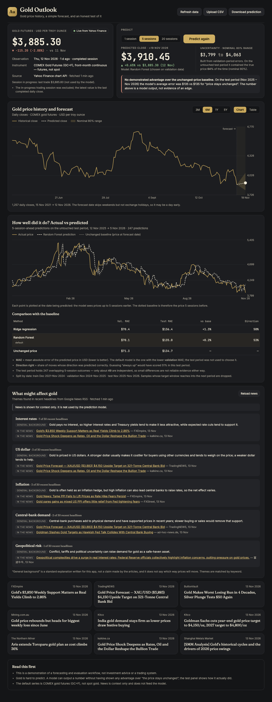
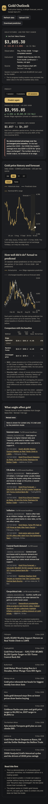

# Gold Outlook

A small gold price forecasting and **evaluation** dashboard. It loads five years of daily gold futures prices, predicts the price 1, 5 or 20 trading sessions ahead with two simple models, and tests those predictions honestly against a "price stays unchanged" baseline on a held-out period. Recent gold news is shown alongside, separate from the model.



<p>

</p>

> This is a demonstration project, not investment advice or a trading system. It makes no claim of profitability. On the data tested, **neither model showed an advantage over the unchanged-price baseline** (see [Results](#results)) and the app says so on screen.

## Run it

Requires Python 3.11+ and Node 20+.

```bash
./start.sh
```

Open http://127.0.0.1:8742. The first run creates a virtualenv, installs the pinned dependencies, builds the frontend and starts the server (~1 min); later runs start immediately. Use `PORT=9000 ./start.sh` for another port.

Development mode (hot reload): run `backend/.venv/bin/uvicorn app.main:app --port 8742` in `backend/` and `npm run dev` in `frontend/` (http://localhost:5173, proxies `/api`).

## Demo script (2 minutes)

1. **Open the app.** Latest close, observation date, a *Live* / *Cached* badge, and the instrument (gold futures, not spot) are at the top; the history chart is below.
2. **Pick a horizon** (1, 5 or 20 sessions) and click **Predict**. You get the predicted price, expected % change and a nominal 80% range, plus the forecast drawn on the chart.
3. **Read the verdict.** The panel states whether the model beat the unchanged-price baseline on the untouched test period. Scroll to the actual-vs-predicted chart and the comparison table (Ridge, Random Forest, unchanged).
4. **Try the other buttons.** *Download prediction* exports the result as CSV; *Refresh data* re-fetches; *Upload CSV* loads your own `Date,Close` data and re-runs everything.
5. **Scroll to news.** Dated headlines link to their sources, with a short "what might affect gold" explainer. It is context only and does not feed the model.

To demonstrate the fallbacks, start with `GOLD_OFFLINE=1 ./start.sh`: cached data is shown with a warning (or an empty state with CSV upload if there is no cache). Nothing is ever replaced with synthetic data.

## How it works

```
Yahoo Finance (GC=F) ──► data.py ──► features.py ──► model.py ──► FastAPI ──► React dashboard
   cache + CSV upload      validate     12 features    Ridge vs RF      /api/*     Recharts
Google News RSS ───────► news.py ───────────────────────────────────────────────► (separate)
```

- **Data**: daily closes of COMEX gold futures `GC=F` (front-month continuous), USD per troy ounce, five years, from Yahoo Finance's unofficial chart endpoint. This is a **futures** series, not spot gold. The unfinished current session is dropped, so the latest value is always a completed daily close (the in-progress price is shown separately and never modelled). Dates use the exchange's real timezone. Last good fetch is cached in `backend/data/` (git-ignored). CSV upload needs a date column and a `Close`/`Price` column, ≥500 rows, and is validated (dates, positive numbers, duplicates, order, implausible jumps).
- **Features** (all from prices up to day *t*): last 5 daily returns; 5/10/20-session momentum; price vs 5- and 20-session average; 10/20-session volatility.
- **Models** (one per horizon, predicting the forward log return, converted to a price): Ridge regression (standardised, `alpha=100`) and a Random Forest (200 trees, depth 4, min 20 samples per leaf). Baseline: price unchanged. Hyperparameters are fixed, not searched.
- **Evaluation**: one chronological split per horizon.

  ```
  |------ train 60% ------|-- validation 20% --|-- test 20% (untouched) --|
  ```
  Both models are fitted on train and compared on validation; the lower validation MAE picks the **default model**. The test period is not used for that choice. The 80% range comes from the default model's validation errors. The test period is then scored once. A sample whose target window (t, t+h] reaches into a later period is dropped at each boundary (purging), and features use only past prices — both are unit-tested.
- **Reported**: MAE in USD, directional accuracy (next to an "always up" reference), the observed coverage of the range on the test period, the test sample size, and the *effective* sample size (≈ n/horizon, because multi-session outcomes overlap).
- **News**: Google News RSS (four gold queries, last 3 weeks), de-duplicated, filtered for off-topic items, tagged by keyword into rates / dollar / inflation / geopolitics / central banks. "General background" sentences are written for this app (not extracted from articles) and are labelled as such.

API: `GET /api/prices`, `POST /api/prices/refresh`, `POST /api/prices/upload`, `GET /api/predict?horizon=1|5|20`, `GET /api/predict/download?horizon=…`, `GET /api/news`, `GET /api/health`.

## Results

Measured on 13 Nov 2026 with live `GC=F` data (1,257 daily closes, 15 Nov 2021 → 12 Nov 2026). They change as data updates, and nothing was tuned to improve them. MAE is mean absolute error of the predicted price in USD.

| Horizon | Default (chosen on validation) | Validation MAE: Ridge / RF / unchanged | Test MAE: Ridge / RF / **unchanged** | Direction right: Ridge / RF (always-up) | Test n (≈independent) | Verdict |
|---|---|---|---|---|---|---|
| 1 session | Ridge | 33.0 / 33.1 / 33.1 | 57.7 / 57.9 / **57.4** | 50% / 51% (51%) | 248 (≈248) | No demonstrated advantage |
| 5 sessions | Random Forest | 70.4 / 70.1 / 71.3 | 136.4 / 135.0 / **134.7** | 50% / 53% (51%) | 247 (≈49) | No demonstrated advantage |
| 20 sessions | Ridge | 130.4 / 133.9 / 147.0 | 283.8 / 288.2 / **270.4** | 47% / 45% (45%) | 244 (≈12) | No demonstrated advantage |

Test periods end between 15 Oct and 11 Nov 2026 (each starts ~1 year earlier).

What this shows:

- **No advantage over "unchanged"** on the test year at any horizon. The 20-session models were better than the baseline on validation but worse on the test, a reminder that validation wins can disappear.
- **The ranges were too narrow.** The 80% ranges contained the true price **71% (1 session), 64% (5) and 42% (20)** of the time on the test period, because the test year was much more volatile than the validation year (baseline MAE roughly doubled). The UI shows nominal and observed coverage side by side.
- At 5 and 20 sessions only ~49 and ~12 outcomes are independent, so even small differences between methods are not reliable evidence.

The app's verdict rule, fixed in advance: "beat the baseline" requires ≥2% lower test MAE than unchanged; otherwise "No demonstrated advantage".

## Limitations

- Gold at these horizons is close to a random walk; simple models on past prices have little to learn from. A model can produce a prediction without having shown any edge.
- One train/validation/test split per horizon is simple and clear but is a single sample of history; results can differ in another period. The test models are fitted once before the test year rather than refitted through it.
- The range is built from validation errors and assumes similar volatility later, which did not hold (see above). It is indicative only.
- `GC=F` is a futures series (not spot); contract rolls can add small jumps. Forecast dates skip weekends but not exchange holidays, so a date can be a day early.
- Yahoo's endpoint is unofficial and may rate-limit or change. News themes are keyword matches on headlines; the news is not a model input and says nothing about direction.

## Tests and verification

```bash
cd backend && .venv/bin/pip install -r requirements-dev.txt && .venv/bin/python -m pytest -q   # 44 tests
cd frontend && npm run build                                                                    # type-check + production build
```

Backend tests cover validation of uploads and provider data, DST-correct date handling, cache/outage fallbacks (never synthetic data), feature causality, purging, validation results not depending on test-period prices, a random-walk sanity check, and the API contract. The UI was also exercised in a real browser (Chrome via Playwright): horizon switching, Predict, refresh, valid and invalid CSV upload, download, provider failure with cache, provider failure with no cache, console/network errors, and the 390px layout.

## Notes

- An early version converted Yahoo timestamps with a single fixed UTC offset, which put bars on the wrong date during daylight-saving months. It now converts per timestamp with the exchange timezone, with a regression test.
- The brief suggested [brianrisk/Stock-Prediction-Neural-Network-and-Machine-Learning-Examples](https://github.com/brianrisk/Stock-Prediction-Neural-Network-and-Machine-Learning-Examples) as a simple reference. I only checked its licence (Apache-2.0 per the GitHub API); I did not read or reuse its code.
- Dependencies are pinned in `backend/requirements.txt` (full lock in `backend/requirements.lock`) and `frontend/package-lock.json`. Optional settings are listed in `.env.example`.
