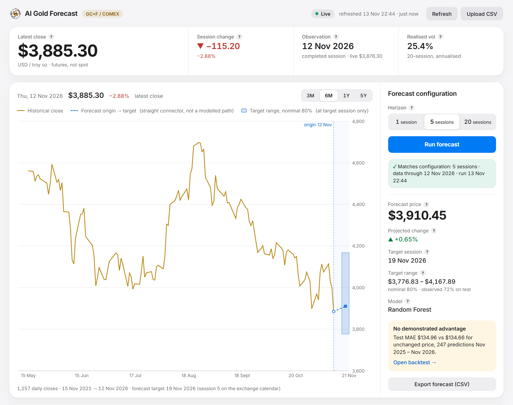
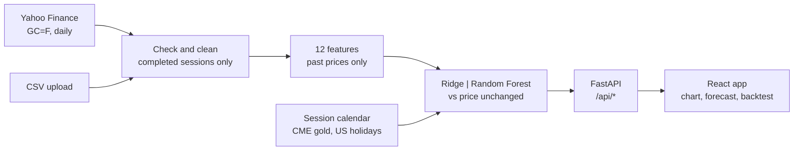
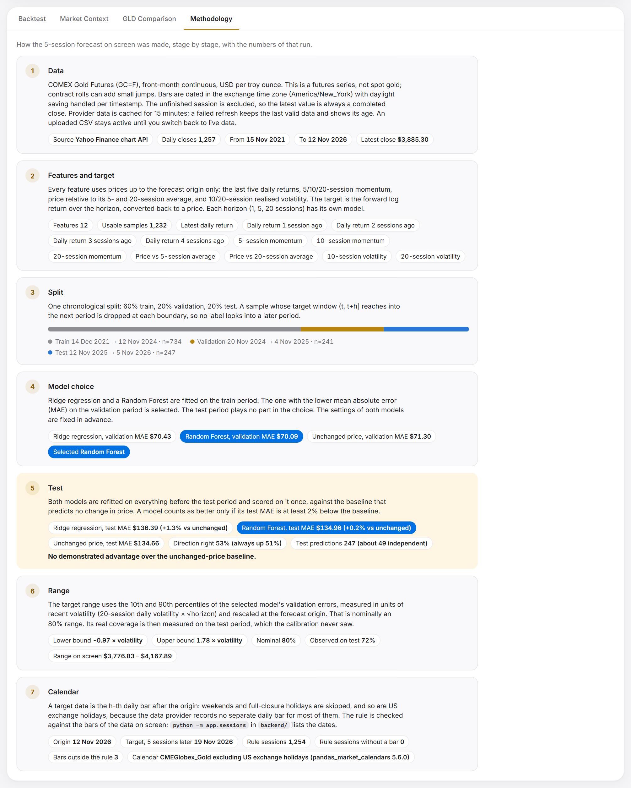
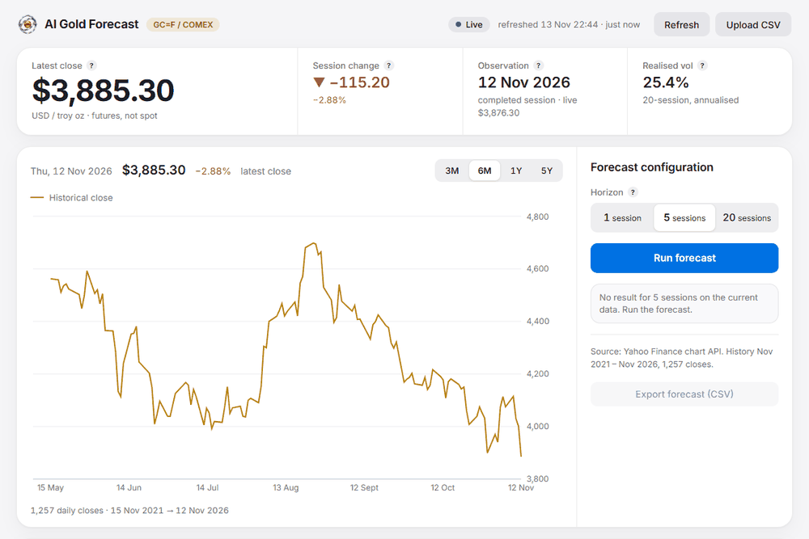
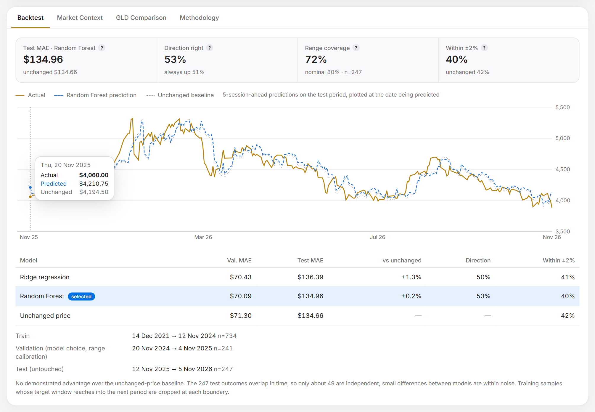
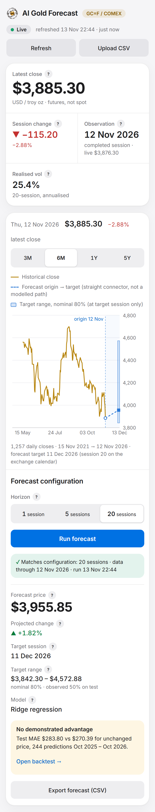

<p align="center">
  
</p>

<h1 align="center">AI Gold Forecast</h1>

<p align="center">
  <b>Gold price forecasts that are graded against the simplest opponent: "the price will not change".</b><br>
  COMEX gold futures · 1, 5 or 20 sessions ahead · two models and a baseline · every number shown
</p>

<p align="center">
  
  
  
  
  
  
  
  
  <a href="LICENSE"></a>
</p>

<p align="center">
  <a href="#what-it-is">What it is</a> ·
  <a href="#why-it-is-different">Why it is different</a> ·
  <a href="#honest-results-so-far">Results</a> ·
  <a href="#how-it-works">How it works</a> ·
  <a href="#run-it-yourself">Run it yourself</a> ·
  <a href="#the-app">The app</a> ·
  <a href="#development">Development</a>
</p>

---

> [!IMPORTANT]
> **This is an ongoing project.** It is still being developed and will keep getting updates, so the models, the screens and the results on this page will change. The [commit history](https://github.com/Martysunshine/ai-gold-forecast/commits/main) shows what changed and when.

## What it is

AI Gold Forecast is a small research app. It downloads five years of daily gold futures prices, trains two simple models, and forecasts the closing price 1, 5 or 20 trading sessions ahead.

Then it does the part most price-prediction demos leave out. It grades those forecasts on a year of prices the models never saw, next to a baseline that predicts no change at all. So far the baseline wins, and the app says so on every forecast.

<picture>
  <source media="(prefers-color-scheme: dark)" srcset="docs/screenshots/app-dark.png">
  
</picture>

<sub>The workspace after a 5-session forecast. The yellow note is computed from the test, not written by hand.</sub>

> [!NOTE]
> This app forecasts. It places no orders, holds no account and needs no API key. The forecasts are model outputs, not trading signals.

## Why it is different

<table>
  <tr>
    <td width="50%" valign="top" align="center">
      <br>
      <b>Only real, completed sessions</b><br><br>
      <sub>Five years of COMEX gold futures (<code>GC=F</code>) daily closes. A session still in progress is dropped, dates follow the exchange's own time zone, and missing data is never filled in. If the provider fails, the last valid data stays and its age is shown.<br><br>
      <a href="backend/app/data.py">data.py</a> · <a href="backend/app/sessions.py">sessions.py</a></sub>
    </td>
    <td width="50%" valign="top" align="center">
      <br>
      <b>Two models and a baseline</b><br><br>
      <sub>Ridge regression and a Random Forest, each fed 12 features built from past prices only. Their settings are fixed in advance and never tuned on the test year. The third contender predicts that nothing moves.<br><br>
      <a href="backend/app/features.py">features.py</a> · <a href="backend/app/model.py">model.py</a></sub>
    </td>
  </tr>
  <tr>
    <td width="50%" valign="top" align="center">
      <br>
      <b>Graded on a year it never saw</b><br><br>
      <sub>One split in time order: 60% to train, 20% to pick the model, 20% to test, scored once. A sample whose outcome reaches into the next period is dropped. A model counts as better only if its average miss is at least 2% below the baseline's.<br><br>
      <a href="backend/app/model.py">model.py</a> · <a href="backend/tests/test_model.py">leakage tests</a></sub>
    </td>
    <td width="50%" valign="top" align="center">
      <br>
      <b>A range, and how often it held</b><br><br>
      <sub>Every forecast comes with a range that should hold 80% of the time, scaled by how much gold has been moving lately. Beside it the app prints how often that range really held on the test year: 83%, 72% and 50% for the three horizons.<br><br>
      <a href="docs/how-it-works.md#7-the-range">how the range is built</a></sub>
    </td>
  </tr>
</table>

## Honest results so far

**Neither model beat "price unchanged" on the test year, at any horizon.** That is the result, so it is at the top.

Prices through 12 Nov 2026: 1,257 daily closes from 15 Nov 2021. "Average miss" is the mean absolute error (MAE): the average distance between the forecast and the price that followed, in US dollars per troy ounce. Lower is better; **bold** marks the best.

| Horizon | Model picked | Test year | Avg miss: Ridge | Avg miss: Random Forest | Avg miss: price unchanged | Direction right (picked / "always up") | 80% range held |
| --- | --- | --- | ---: | ---: | ---: | --- | ---: |
| 1 session | Ridge | 17 Nov 2025 to 11 Nov 2026, 248 forecasts | $57.67 | $57.88 | **$57.43** | 50% / 51% | 83% |
| 5 sessions | Random Forest | 12 Nov 2025 to 5 Nov 2026, 247 forecasts | $136.39 | $134.96 | **$134.66** | 53% / 51% | 72% |
| 20 sessions | Ridge | 27 Oct 2025 to 15 Oct 2026, 244 forecasts | $283.80 | $288.16 | **$270.39** | 47% / 45% | 50% |

What the table says:

- **At 5 sessions the gap is 30 cents on a $135 miss.** That is noise. The 247 test forecasts overlap in time, so only about 49 are independent.
- **At 20 sessions both models looked good, then failed.** On the validation year they beat the baseline ($130.37 and $133.86 against $146.98). On the test year both lost to it. One year can flatter a model.
- **The ranges held at 1 session and were too narrow beyond that.** The app prints the real figure beside every range for this reason.
- **Daily gold is close to a random walk.** The value here is the grading: a setup that follows the exchange calendar, is tested for leaks, and would show real skill if a model had any.

The numbers change as new prices arrive. The app always shows the current ones.

## How it works



**[docs/how-it-works.md](docs/how-it-works.md) follows one real forecast from the first price to the final range, with every number.** The app does the same in its Methodology tab, filled in with the numbers of whatever forecast is on screen:

<picture>
  <source media="(prefers-color-scheme: dark)" srcset="docs/screenshots/walkthrough-dark.png">
  
</picture>

Picking a horizon, running it, and opening the backtest:



<table>
<tr>
<td width="68%" valign="top">
<picture>
  <source media="(prefers-color-scheme: dark)" srcset="docs/screenshots/backtest-dark.png">
  
</picture>
</td>
<td width="32%" valign="top">
<picture>
  <source media="(prefers-color-scheme: dark)" srcset="docs/screenshots/mobile-dark.png">
  
</picture>
</td>
</tr>
<tr>
<td><sub>Backtest: every test forecast against the price that followed and against the baseline.</sub></td>
<td><sub>On a phone, 390 px wide.</sub></td>
</tr>
</table>

The parts:

| Part | Where | What it does |
| --- | --- | --- |
| Data | [`backend/app/data.py`](backend/app/data.py) | Fetches, validates and caches prices; validates CSV uploads |
| Calendar | [`backend/app/sessions.py`](backend/app/sessions.py) | Decides which future dates are trading sessions |
| Features | [`backend/app/features.py`](backend/app/features.py) | 12 numbers per day, from past prices only |
| Models and grading | [`backend/app/model.py`](backend/app/model.py) | Split, model choice, test, forecast, range |
| API | [`backend/app/main.py`](backend/app/main.py) | Serves the numbers and the built app on one port |
| App | [`frontend/src/`](frontend/src) | React, TypeScript and Recharts |
| Checks | [`backend/tests/`](backend/tests), [`e2e/`](e2e) | 84 backend tests, 68 browser checks |

## Run it yourself

You need Python 3.11 or newer, Node.js 20 or newer, and an internet connection for prices and headlines. No API key.

**Windows**

```bat
git clone https://github.com/Martysunshine/ai-gold-forecast.git
cd ai-gold-forecast
start.cmd
```

**macOS and Linux**

```bash
git clone https://github.com/Martysunshine/ai-gold-forecast.git
cd ai-gold-forecast
./start.sh
```

The app opens at **http://localhost:8742**. The first run creates `backend/.venv`, installs the pinned packages and builds the app, which takes about a minute. Later runs start at once. Keep the window open while you use the app.

| To | Windows | macOS and Linux |
| --- | --- | --- |
| Use another port | `start.cmd -Port 9000` | `PORT=9000 ./start.sh` |
| Work without the internet (cached data or a CSV only) | `set GOLD_OFFLINE=1` then `start.cmd` | `GOLD_OFFLINE=1 ./start.sh` |

Optional settings are listed in [`.env.example`](.env.example).

The Windows launcher was checked on Windows 11 with Python 3.12 and Node 24. `start.sh` comes from the original project, where it was tested on macOS.

## The app

| Part of the screen | What it shows |
| --- | --- |
| **Market strip** | The latest completed close, its change, its date and how much the price has been moving. A price from a session still in progress is shown separately and never modelled. |
| **Price chart** | 3 months to 5 years of closes. After a forecast: the origin, a straight line to the target session, and the range at that session only. The line is not a predicted daily path. |
| **Forecast panel** | Horizon (1, 5 or 20 sessions), the forecast price, the change, the target date, the range with its real coverage, and the model used. A status line says whether the result matches the data and horizon on screen, so an old result is never shown as current. |
| **Backtest tab** | Average miss, direction, range coverage and the share of forecasts within 2%, for both models and the baseline, with the chart and the exact dates of each period. |
| **Market Context tab** | Recent gold headlines with sources. They are background reading and never feed the model. |
| **GLD Comparison tab** | Optional. The GLD fund beside the futures, both indexed to 100. Needs Alpaca market-data keys. |
| **Methodology tab** | The forecast on screen, stage by stage, with its own numbers. |
| **Data buttons** | Refresh, upload a CSV (checked before anything is replaced), go back to live data, and export the forecast as CSV. |

The app follows your system's light or dark setting.

<details>
<summary><b>Data and market conventions</b></summary>

| Topic | Convention |
| --- | --- |
| **Instrument** | COMEX gold futures, front-month continuous (`GC=F`), US dollars per troy ounce. This is futures, not spot gold, so a change of contract can add a small jump. |
| **Provider** | Yahoo Finance chart endpoint, five years of daily bars. The endpoint is unofficial and may be rate-limited or change. |
| **Completed sessions** | A bar for a session still in progress is dropped. The latest close is always a finished session. |
| **Time zone** | Bars are dated in `America/New_York`, converted per timestamp, so daylight saving is handled. A test covers this. |
| **Calendar** | A target is the h-th future session: CME Globex gold sessions minus US exchange holidays (`pandas_market_calendars`). The Methodology tab shows how well this rule matches the bars of the data on screen; on five years of data through 12 Nov 2026, all 1,254 rule sessions had a bar. |
| **Cache** | Provider data is cached on disk for 15 minutes. A failed refresh keeps the last valid data and shows its age. With no data at all, the app shows an empty state. |
| **CSV upload** | Needs a date column, a `Close` or `Price` column and at least 500 rows. Dates, positive values, duplicates, order, future dates and implausible jumps are checked. A bad file is rejected and the active data is left alone. |
| **News** | Google News RSS headlines with source links. Themes are keyword matches. Not a model input. |

</details>

<details>
<summary><b>Optional: the GLD comparison</b></summary>

Alpaca does not carry gold futures, so it is used for one read-only job: daily bars of the GLD fund, shown beside `GC=F`. GLD is a different instrument, priced per share, and never a model input. The app calls no order or account endpoint.

Copy `.env.example` to `.env`, set `ALPACA_API_KEY_ID` and `ALPACA_API_SECRET_KEY` (paper or market-data keys), and start the app again. `ALPACA_DATA_FEED=iex` works on the free plan. Keys are read on the server only; they never appear in the app, in API responses, in logs or in error messages, and tests check this. `.env` is ignored by git. Without keys the tab shows these steps and everything else works.

</details>

<details>
<summary><b>API</b></summary>

| Endpoint | Purpose |
| --- | --- |
| `GET /api/health` | Is the server up |
| `GET /api/prices` | The active data, latest close, session status, age, recent volatility, and a `data_key` that changes when the data changes |
| `POST /api/prices/refresh` | Fetch again; on failure keep the last valid data and report `provider_error` |
| `POST /api/prices/use-provider` | Leave an uploaded file and return to provider data |
| `POST /api/prices/upload` | Check and activate a CSV (`422` leaves the active data unchanged) |
| `GET /api/predict?horizon=1\|5\|20` | Forecast, range, backtest series, metrics and calendar check, tagged with the `data_key` they used |
| `GET /api/predict/download?horizon=…&key=…` | The forecast as CSV; `409` if the data has changed since |
| `GET /api/news` | Recent gold headlines with sources and themes |
| `GET /api/compare/gld` | The optional GLD comparison; `{"configured": false}` with setup steps when no keys are set |

</details>

## Development

Hot reload, in two windows. Run the launcher once first so `backend/.venv` exists.

```bash
# backend            (Windows: backend\.venv\Scripts\uvicorn app.main:app --reload --port 8742, from backend\)
cd backend && .venv/bin/uvicorn app.main:app --reload --port 8742

# frontend: http://localhost:5183, passes /api on to port 8742
cd frontend && npm run dev
```

Checks:

| Check | Windows | macOS and Linux |
| --- | --- | --- |
| Backend, 84 tests | `backend\.venv\Scripts\python -m pip install -r backend\requirements-dev.txt` then, in `backend\`, `.venv\Scripts\python -m pytest -q` | `cd backend && .venv/bin/pip install -r requirements-dev.txt && .venv/bin/python -m pytest -q` |
| Types and build | `npm run build` in `frontend\` | `cd frontend && npm run build` |
| Browser, 68 checks (needs Chrome or Edge, and the internet) | `e2e\run.cmd` | `./e2e/run.sh` |
| Retake the README screenshots | `set SHOTS=docs\screenshots` then `e2e\run.cmd -Script shots.mjs` | `SHOTS=./docs/screenshots ./e2e/run.sh shots.mjs` |

<details>
<summary><b>What the checks cover</b></summary>

- **Backend (pytest):**
  - validation of uploads and provider data, dates across daylight saving, the session calendar
  - features use past prices only; no training label reaches into a later period; the model choice and the range do not depend on test prices
  - the three horizons agree with each other, the CSV export matches the API, and a stale export is refused (`409`)
  - caching, provider outages, safe uploads, the return to live data
  - the Alpaca client: paging, error handling, cache, and key values never appearing in any response
- **Browser (`e2e/`, the installed Chrome or Edge), against the production build:**
  - the full forecast flow, the export against the numbers on screen, refresh, good and bad uploads
  - the Methodology stages against the API values of the forecast on screen
  - provider failure with and without cached data, and a news outage
  - the GLD tab with and without keys, and keyboard use
  - layout, overflow and touch-target size at 1440, 768 and 390 px
  - text contrast, measured on the rendered page in the light and the dark theme

</details>

Packages are pinned in `backend/requirements.txt` (full lock in `backend/requirements.lock`) and in the two `package-lock.json` files. See [CONTRIBUTING.md](CONTRIBUTING.md) before changing anything, and [SECURITY.md](SECURITY.md) for reporting a problem.

## Relation to AI Stock Trader

This is a sister project of [AI Stock Trader](https://github.com/Martysunshine/ai-stock-trader), an automated trading system that has to prove an edge before it may touch real money. The two share a design and an attitude: results are published as they are.

They are separate on purpose. If they are joined later, this is what would move:

- **The forecast code** (`data.py`, `features.py`, `model.py`, `sessions.py`) as a research module. These four files import nothing from the web server, so they can be lifted out as they are.
- **The screens** as a gold page in the trader's console, which already uses the same design tokens.

And what would not: **a trading rule.** A model that does not beat "price unchanged" cannot place trades under AI Stock Trader's rules. Its own tests of gold rules found no edge either.

## Research notes

- One split in time is one draw from history. Another test year can give another verdict.
- Scaling the range by volatility was adopted after fixed-width ranges held too rarely on test (71%, 64%, 42%), so the test year informed that design choice. On history ending 250 and 500 sessions earlier, the same method gave 74% / 67% / 64% and 82% / 88% / 93%. Coverage depends on the period.
- Up-or-down classifiers (logistic regression, random forest) were also tried. At 20 sessions they scored 75 to 78% on validation and 46 to 47% on test, because gold rose through the validation year. They were not adopted.
- The 20-session range is lopsided because the validation errors were lopsided. The method keeps that rather than forcing a symmetric range.

> [!WARNING]
> This is a research project, not financial advice. Nothing here claims or implies profitable trading. Market data comes from Yahoo Finance and, optionally, Alpaca; headlines come from Google News. Each source has its own terms of use.

## Credits and licence

AI Gold Forecast is built on [Gold Outlook](https://github.com/Prits3/gold_trading_prediction) by [Prits3](https://github.com/Prits3). The forecasting method, the evaluation and the first version of the app are that project's work, and its commits are kept in this repository's history. Added here: the name and design, the Windows launchers, the stage-by-stage Methodology tab with its live calendar check, light and dark themes, and contrast checks measured on the page.

The banner, the emblems and the app mark were generated with AI image tools (GPT Image through Higgsfield).

**Licence.** The work added in this repository is released under the [MIT licence](LICENSE): the design, the Windows launchers, the Methodology walk-through, the checks added here and the documentation. The code that comes from Gold Outlook remains the copyright of its author, who has not published a licence for it; to reuse those parts, ask the author. Third-party packages remain under their own licences.

Created by martin.matysek
