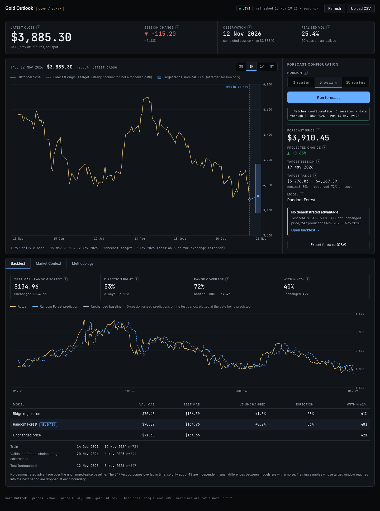
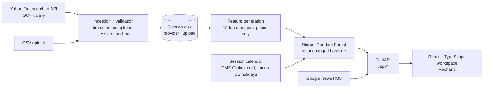

# Gold Outlook

A gold futures forecasting and evaluation workspace.

Historical market data, short-horizon forecasts and chronological model evaluation in a single interface. Built with Python, FastAPI, scikit-learn, React and TypeScript.



## Interface

A single workspace for one instrument, COMEX gold futures (`GC=F`).

1. **Market strip.** Latest completed close, session change, observation date and 20-session realised volatility. Each metric has a definition on hover or keyboard focus.
2. **Chart and forecast configuration.** Choose a horizon (1, 5 or 20 sessions) and run the forecast. The chart marks the forecast origin, draws a straight connector to the target session, and shades the target range at that session only. The connector is not a modelled daily path. A status line states whether the displayed result matches the selected horizon and the current data.
3. **Research tabs.** *Backtest* shows actual vs predicted prices on the held-out test period, a comparison against an unchanged-price baseline, evaluation dates, MAE and the measured coverage of the range. *Market Context* lists recent gold headlines with sources and links; news is context and is not an input to the forecast. *Methodology* summarises the data, features, evaluation, calendar and uncertainty handling.
4. **Data controls.** Refresh, CSV upload, "Use live data" (to leave an uploaded file), and a CSV export of the displayed forecast.

The layout stacks at narrow widths; it was checked at 390, 768 and 1440 px ([768](docs/screenshots/workspace-768.png), [390](docs/screenshots/workspace-390.png)).

## Quick start

Requires Python 3.11+ and Node 20+ (and network access for prices and headlines).

```bash
./start.sh
```

Open http://localhost:8742 (the script opens it for you). The first run creates `backend/.venv`, installs the pinned dependencies, builds the frontend and starts the server (about a minute); later runs start immediately. Keep the terminal open while using the app.

```bash
PORT=9000 ./start.sh          # use another port
GOLD_OFFLINE=1 ./start.sh     # never call external providers: cached data or CSV upload only
```

Development with hot reload: run `.venv/bin/uvicorn app.main:app --port 8742` in `backend/`, and `npm run dev` in `frontend/`, then open http://localhost:5183 (it proxies `/api` to port 8742). Optional settings are listed in [`.env.example`](.env.example).

## System design



## Forecasting approach

- **Target.** The forward log return over the horizon (1, 5 or 20 daily bars), converted to a price. One model per horizon.
- **Features** (12, each computed from closes up to and including the forecast origin): the last five daily returns; 5-, 10- and 20-session momentum; price relative to its 5- and 20-session average; 10- and 20-session realised volatility.
- **Models.** Ridge regression (standardised inputs, `alpha=100`) and a Random Forest (200 trees, depth 4, at least 20 samples per leaf, half of the features per split). Hyperparameters are fixed, not searched. Baseline: price unchanged.
- **Selection.** The model with the lower validation MAE (mean absolute error of the predicted price, in USD) is selected for each horizon. The test period plays no part in that choice.
- **Forecast.** The selected model is refitted on all labelled samples and applied to the latest features.

## Evaluation

One chronological split per horizon: 60% train, 20% validation, 20% test, with the same origins used for every method.

- Both models are fitted on **train**; **validation** selects the model and calibrates the range.
- A sample at date *t* has a target window (*t*, *t+h*]. A sample is used only if its window ends before the next period starts, so no training or validation target reaches into a later period (purging).
- The **test** period is scored once, after refitting on everything before it.
- **Range.** The 10th and 90th percentiles of the selected model's validation errors, expressed in units of recent volatility (20-session daily volatility × √horizon at each origin), are rescaled at the forecast origin. This gives a nominal 80% range. Its coverage is then measured on the test period.

Results on live data, 13 Nov 2026 (1,257 daily closes, 15 Nov 2021 → 12 Nov 2026; 1,232 usable samples for 5 sessions: 734 train, 241 validation, 247 test). MAE in USD.

| Horizon | Selected | Validation MAE (Ridge / RF / unchanged) | Test MAE (Ridge / RF / **unchanged**) | Test period | Test n (≈ independent) | Direction right (Ridge / RF; always-up) | Range coverage (nominal 80%) |
|---|---|---|---|---|---|---|---|
| 1 | Ridge | 32.96 / 33.10 / 33.07 | 57.67 / 57.88 / **57.43** | 17 Nov 2025 → 11 Nov 2026 | 248 (≈248) | 50% / 51%; 51% | 83% |
| 5 | Random Forest | 70.43 / 70.09 / 71.30 | 136.39 / 134.96 / **134.66** | 12 Nov 2025 → 5 Nov 2026 | 247 (≈49) | 50% / 53%; 51% | 72% |
| 20 | Ridge | 130.37 / 133.86 / 146.98 | 283.80 / 288.16 / **270.39** | 27 Oct 2025 → 15 Oct 2026 | 244 (≈12) | 47% / 45%; 45% | 50% |

Reading the table:

- **Neither model beat the unchanged-price baseline on the test period at any horizon.** At 20 sessions both models were ahead of the baseline on validation and behind it on test. The interface labels this "No demonstrated advantage" next to every forecast.
- **Range coverage** was 83%, 72% and 50% against a nominal 80%. The 5- and 20-session ranges were too narrow on the test year.
- Overlapping multi-session outcomes are not independent. The "≈ independent" count is n ÷ horizon, so at 20 sessions about 12 independent outcomes support these comparisons.
- Price accuracy within ±2% of the actual price was 79% (1 session), 40% (5) and 16% (20) for the selected model, against 80%, 42% and 15% for unchanged. Wide tolerances reward calm markets, not skill.

## Data and market conventions

| Topic | Convention |
|---|---|
| Instrument | COMEX gold futures, front-month continuous series (`GC=F`), USD per troy ounce. A futures series, not spot gold; contract rolls can introduce small jumps. |
| Source | Yahoo Finance chart endpoint, five years of daily bars. The endpoint is unofficial and may be rate-limited or change. |
| Completed sessions | A bar for a session still in progress is dropped. The latest close is always a completed session; the in-progress price is displayed separately and never modelled. |
| Time zone | Bars are dated in `America/New_York`, converted per timestamp so daylight saving is handled correctly (an earlier fixed-offset conversion misdated bars in summer months; covered by a regression test). |
| Session calendar | Target dates are the *h*-th future daily bar: CME Globex gold sessions (`pandas_market_calendars`, `CMEGlobex_Gold`) minus US exchange holidays. CME runs abbreviated sessions on those holidays, but the provider records no separate daily bar for most of them. Checked on 13 Nov 2026 against the five-year series: all 1,254 rule sessions had a bar, 3 observed bars fell outside the rule (23 Nov 2023, 9 Jan 2025, 4 Jul 2025), and the unfiltered gold calendar would have added 33 days with no bar. Reproduce with `cd backend && .venv/bin/python -m app.sessions`. |
| Cache | Provider data is cached on disk for 15 minutes. A failed refresh keeps the last valid dataset and shows its age. Uploaded CSVs live in a separate slot and stay active until "Use live data" is chosen; an invalid upload is rejected before anything is written. |
| CSV upload | A date column and a `Close` / `Price` column, at least 500 rows. Validated for dates, positive numbers, duplicates, ordering, future dates and implausible jumps. Units and instrument of an upload cannot be verified. |
| Missing data | Nothing is substituted. With no provider data and no cache the interface shows an empty state. |

## API

| Endpoint | Purpose |
|---|---|
| `GET /api/health` | Liveness check. |
| `GET /api/prices` | Active dataset: closes, latest observation, session status, data age, realised volatility, `data_key`. |
| `POST /api/prices/refresh` | Re-fetch provider data. On failure the last valid data is returned with `provider_error`. |
| `POST /api/prices/use-provider` | Switch from an uploaded file back to provider data (live, or the saved provider copy). |
| `POST /api/prices/upload` | Validate and activate an uploaded CSV (`422` leaves the active data unchanged). |
| `GET /api/predict?horizon=1\|5\|20` | Forecast, range, backtest series and metrics for the active data. Results carry the `data_key` they were computed from. |
| `GET /api/predict/download?horizon=…&key=…` | CSV of the forecast; `409` if the active data no longer matches `key`. |
| `GET /api/news[?refresh=true]` | Recent gold headlines with sources, dates and keyword themes. |

## Verification

```bash
cd backend && .venv/bin/pip install -r requirements-dev.txt && .venv/bin/python -m pytest -q   # 68 tests
cd frontend && npm run build                                                                    # type-check + production build
./e2e/run.sh                                                                                    # 57 browser checks (needs Chrome and internet)
```

- **Backend tests** cover upload and provider validation, DST-correct dates, the session calendar, feature causality, purging, validation results and range calibration not depending on test-period prices, consistency of all three horizons, export parity with the API, stale-data rejection, caching, cache and outage fallbacks, upload safety and the return to provider data.
- **Browser checks** (`e2e/`, Chrome via `playwright-core`) run against the production build served by FastAPI: the full forecast workflow at 1440 px, export values against the displayed forecast, refresh, valid and invalid CSV upload, provider failure with and without a cache, a news outage, keyboard operation, and layout, overflow, touch-target and contrast checks at 1440, 768 and 390 px.

## Project structure

| Path | Contents |
|---|---|
| `backend/app/` | `data.py` ingestion, validation and cache; `features.py`; `model.py` models and evaluation; `sessions.py` calendar; `news.py`; `main.py` API. |
| `backend/tests/` | pytest suite. |
| `frontend/src/` | `App.tsx` state and layout; `components/` market strip, chart, forecast panel, research tabs; `styles.css`. |
| `e2e/` | Browser end-to-end checks and the runner. |
| `docs/screenshots/` | Screenshots used above, produced by the browser checks. |
| `start.sh` | Install, build and run in one command. |

## Research notes

- The selected models do not show a measured advantage over the unchanged-price baseline. The forecast numbers are model outputs, not evidence of skill, and nothing here is a trading signal or a performance claim.
- One split per horizon is one sample of history. Different test periods can give different results.
- The volatility scaling of the range was introduced after fixed-width ranges covered only 71%, 64% and 42% of test outcomes (1, 5, 20 sessions), so the test year informed that design choice. As an out-of-time check at implementation, the same procedure applied to history ending 250 and 500 sessions earlier gave 74% / 67% / 64% and 82% / 88% / 93% coverage, so coverage varies widely by period.
- Direction classifiers (logistic regression, random forest) were also tried on the same split. At 20 sessions they scored 75–78% on validation and 46–47% on the untouched test period, because gold trended up through the validation window. They were not adopted.
- The range is asymmetric when validation errors are skewed, as at 20 sessions, where validation errors were mostly positive.
- Headline themes are keyword matches. The explanatory sentences are general background written for this application, not statements from the articles.
- The brief suggested [brianrisk/Stock-Prediction-Neural-Network-and-Machine-Learning-Examples](https://github.com/brianrisk/Stock-Prediction-Neural-Network-and-Machine-Learning-Examples) as a simple reference. I only checked its licence (Apache-2.0 per the GitHub API); I did not read or reuse its code.

Dependencies are pinned in `backend/requirements.txt` (full lock in `backend/requirements.lock`) and `frontend/package-lock.json`.
