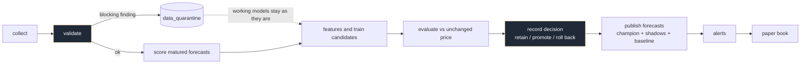
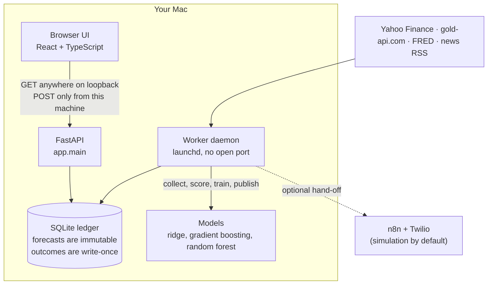
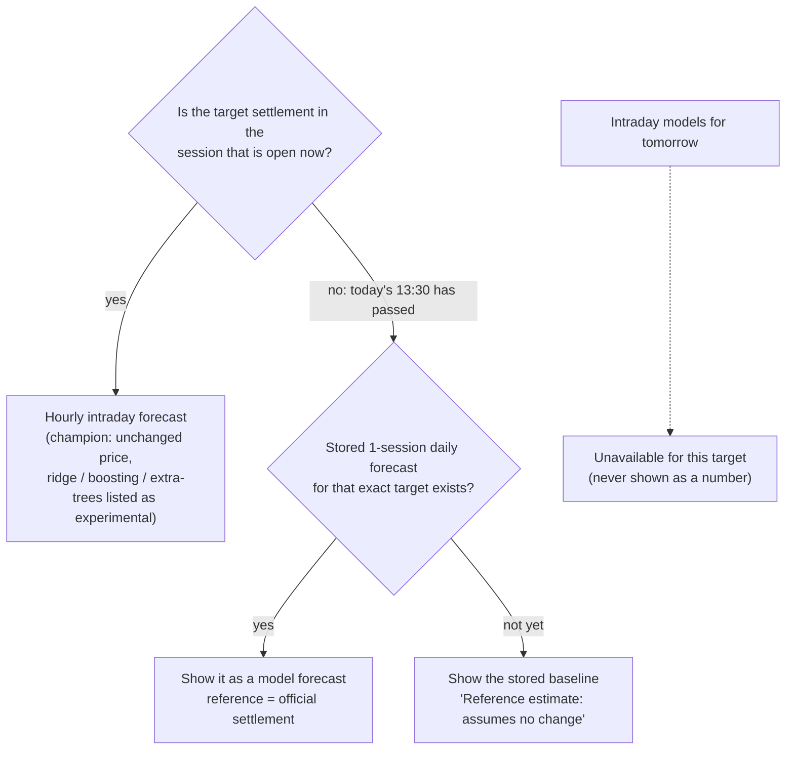
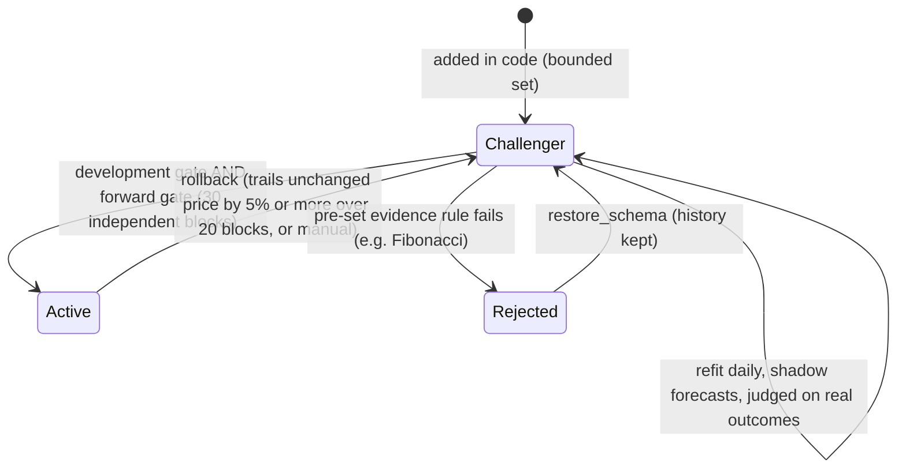

# AI Gold Forecast: the full guide

[← Back to the README](../README.md)

**Jump to:** [Start](#start) · [How the pieces fit](#how-the-pieces-fit) · [The screen](#the-screen) · [How learning works](#how-learning-works) · [Current measured results](#current-measured-results) · [Verified manually vs on schedule](#verified-manually-vs-on-schedule) · [Paper trading](#paper-trading-simulation-only) · [Alerts](#alerts-sell-review-notifications) · [Data sources](#data-sources-and-their-real-delays) · [Development](#development)

> **No model beats "the price stays put" at any horizon tested, and there are 0 matured forward forecasts so far.** The app records the evidence needed to find out. Details below.

## Start

```bash
./start.sh                 # installs on first run, builds the UI, serves http://localhost:8742 (the next free port if another program has it; the URL is printed)
PORT=9000 ./start.sh       # another port
```

<details>
<summary><b>Try it in 60 seconds</b> (checklist)</summary>

- [ ] `./start.sh`: the app opens in your browser (it prints the URL; if `8742` is taken it uses the next free port)
- [ ] On **Forecast**, choose **5 sessions** and press **Predict**: the forecast appears on the chart and in the panel beside it
- [ ] Press **Next settlement** then **Predict**: the card says what produced the number
- [ ] Open the **Learning** page: the worker, the active model per horizon, and the scheduled-cycle record
- [ ] `./scripts/worker.sh status`: which runtime is operating and what ran last

</details>

The web app starts an in-process background worker **only if no standalone worker is running**. For jobs that keep running with the browser, server and terminal closed, install the standalone worker (below).

### Background worker (Windows)

Run `backend\.venv\Scripts\python -m app.worker run` in a window that stays open (set `GOLD_RUNTIME=windows` so the status and the Learning page name it). A second copy waits on the lock and takes over when the first one ends, so a launcher may simply restart it after any exit. `status`, `cycles`, `once` and `rollback` work as below with `.venv\Scripts\python` in place of `.venv/bin/python`. The worker stops while the PC sleeps or is off; on the next start it runs a catch-up cycle when learning is more than 26 h old.

### Background worker (macOS)

<details>
<summary><b>Install, status, logs, restart, uninstall</b></summary>

```bash
./scripts/worker.sh install     # per-user launchd agent; idempotent, starts at login, restarts after a crash
./scripts/worker.sh status      # launchd state, which RUNTIME is operating, what ran last, next jobs
./scripts/worker.sh logs -f     # follow its logs
./scripts/worker.sh restart
./scripts/worker.sh uninstall   # stop and remove (data and logs are kept)
./scripts/worker.sh cycles      # the persisted full-cycle records and whether the 23:30 UTC schedule has run
./scripts/worker.sh once        # one full cycle now, in this terminal (recorded as trigger "manual")
cd backend && PYTHONPATH=. .venv/bin/python -m app.worker rollback fwd_5   # restore the previous champion
```

The worker is its own process: it keeps running with the browser, the web server and the terminal closed (verified: it kept running jobs for 150 s with the web server stopped, and a `kill -9` was followed by an automatic restart). When the launchd agent is installed the web app does **not** start a second, embedded worker. The worker listens on **no port**. Its heartbeat records which runtime is operating (`launchd`, `container`, `web-embedded`, `manual`) and the Learning page and `status` report it. **A sleeping or powered-off Mac records nothing**; on wake the worker re-downloads history and runs any overdue cycle, but spot ticks and hourly intraday forecasts missed while asleep cannot be reconstructed and stay as visible gaps. For an always-on host see [deploy/README.md](../deploy/README.md) (container files, **not built or run here**).

Logs: `~/Library/Logs/ai-gold-forecast/worker.err.log` (the worker's Python log, which goes to stderr; `worker.log` is stdout and normally empty; `./scripts/worker.sh logs` shows both). The durable record is the database: `job_runs` (every job run), `job_state` (failures, back-off, retry limit) and `cycle_runs` (every full cycle, its trigger and each step). `./scripts/worker.sh cycles` prints `cycle_runs`.


<details>
<summary><b>Command cheat sheet</b></summary>

| I want to… | Run |
|---|---|
| Start the app | `./start.sh` (or `PORT=9000 ./start.sh`) |
| Install the background worker | `./scripts/worker.sh install` |
| See what the worker is doing | `./scripts/worker.sh status` |
| Check whether the 23:30 UTC schedule has fired | `./scripts/worker.sh cycles` |
| Read its logs | `./scripts/worker.sh logs -f` |
| Restart or remove it | `./scripts/worker.sh restart` · `./scripts/worker.sh uninstall` |
| Run one full cycle now | `./scripts/worker.sh once` |
| Roll a horizon back to its previous model | `cd backend && PYTHONPATH=. .venv/bin/python -m app.worker rollback fwd_5` |
| Independently re-derive the stored 1/5/20-session forecasts | `cd backend && PYTHONPATH=. .venv/bin/python -m app.forecast_trace` |
| Run every test | see [Development](#development) |

</details>

</details>

### The daily loop

<details>
<summary><b>The loop, its steps and how failures are handled</b></summary>



*Every step of a cycle is recorded in `cycle_runs`. One failing step never stops the rest, and a data problem is quarantined, never deleted.*

| Step | What happens | Written to |
|---|---|---|
| collect | Download daily gold, drivers and news; a day's bar counts only once its session has ended and agrees with the settlement-time price | `data/gc_daily_ohlc.csv`, `news_items` |
| validate | Detect bad data (duplicates, wrong units, stale feed, schema change); quarantine it, never delete it. A *blocking* finding stops training for the day and keeps the working models | `data_quarantine` |
| score | Match every forecast whose target settlement now exists with its actual price, once (outcomes are write-once) | `outcomes` |
| features → train → evaluate | Rebuild features from data up to each date only; refit every bounded candidate on matured labels; compare with the unchanged price on identical dates | `training_attempts`, `dev_series`, `feature_evals` |
| record decision | Retain, promote or roll back per horizon, with the reason | `models` (status), `decisions` |
| publish | Issue the next forecasts (champion, challenger shadows and the unchanged baseline) into the immutable ledger | `forecasts` |
| alerts, paper | Check review levels; evaluate the paper book against stored forecasts | `alert_*`, `paper_*` |

Every step of a cycle is recorded and one failing step never stops the rest (a failed collect still lets alerts and paper run). Jobs have persistent state with bounded back-off (30 s, 2 min, 10 min, then hourly) and a retry limit of 4 in a row; a scheduled or manual cycle starts every job fresh.

</details>

### Schedule, time zone, and what the Mac must be doing

<details>
<summary><b>Schedule, time zone and requirements</b></summary>

| Job | When |
|---|---|
| **Full daily cycle** | **23:30 UTC every day** (a fixed UTC time): 18:30 New York in winter (EST), 19:30 in summer (EDT); 00:30 Berlin in winter, 01:30 in summer. That is after the 17:00 ET close and the settlement bar |
| Learning check | every 5 min: if a completed session's forecasts have not been issued yet, run validate → learn → thresholds now (so fresh data does not wait for 23:30) |
| Collect retry | at most every 15 min while the exchange calendar says a completed session's data should exist but has not arrived |
| Score matured forecasts | every 30 min |
| Next-settlement forecast | hourly |
| Alerts and paper book | every 2 min |
| Spot price recording | every 10 s |

**Requirements.** The Mac must be **awake and online** at the time. launchd starts the worker at login and restarts it after a crash (30 s throttle); it does **not** wake a sleeping Mac. During sleep nothing is collected: spot ticks and hourly intraday forecasts missed in that time are not reconstructed and remain visible gaps. After waking, the 5-minute learning check notices that a completed session is missing, re-downloads and runs the sequence once the data is there, and if the worker is restarted when learning is more than 26 h old it runs a full **catch-up** cycle immediately. A catch-up is recorded as `catch-up`, never as `scheduled`. For hosting that does not depend on this Mac see [deploy/README.md](../deploy/README.md) (written but **not built or run**).

</details>

## How the pieces fit



The browser and the worker never talk to each other: both read and write the same database. That is why training keeps running with the browser closed.

## The screen

Four pages (hash routes: `#/forecast`, `#/learning`, `#/paper`, `#/alerts`). The Forecast page is a research-terminal layout: a market strip, the chart with a **Forecast configuration** panel beside it, and tabs underneath.

**Forecast** (the landing page)

- **Market strip:** latest price, session change, previous close and open, session range, USD per troy oz. Each instrument has its own session convention (below); the two are never mixed.
- **Chart + Forecast configuration.** The chart has Line / Candles and history ranges 1D–5Y. The panel beside it has the horizon (**Next settlement / 1 / 5 / 20 sessions**) and one **Predict** button. Predict fetches the stored forecast for that choice and draws it on the *same* chart: a marker at the forecast origin, a dashed **Illustrative connection** (not a predicted path), a gold dot at the target with its price and New York date/time, and the prediction range. The panel then shows one compact card: the target day (**"Tomorrow · Thu 19 Nov"**), forecast price, projected change, target session (New York and Berlin), target range with its historical coverage, **what produced the number** (a named model, or the explicit sentence *"Reference estimate: assumes no change."*), when it was issued and what input data it used. **Hide forecast** and **Fit forecast** sit on the chart; zoom survives live updates and Line/Candles switches. Changing the horizon clears the result until Predict is pressed again, and a newer forecast is offered, never swapped in. **Export forecast (CSV)** is the displayed forecast, built from the same stored record. An under-calibrated range reads "80% target range · historical coverage 70%".
- **Today's settlement is shown separately** under the chart: the forecast that was stored for it and the actual close, or **"Official close: pending"** until the provider posts it. An old forecast is never reconstructed after the outcome is known.
- **Tabs under the chart:** Backtest, Market drivers, GLD comparison, Methodology, Model & evaluation (the worker, the model per horizon, **experimental model estimates for the shown target**, calibration audit, promotion rules) and News. The Alerts panel, the learning evidence and the paper book are their own pages.
- **Chart** ([TradingView Lightweight Charts™](https://www.tradingview.com/), Apache-2.0, attribution shown): real OHLC candles or a 2px line with light shading, the candle/point interval stated, hover readout, one latest-price marker. Labels on a forecast are collision-resolved and never clip. Provider and session detail sits behind the ⓘ button.

### What "Next settlement" shows, and what is a fallback

<details open>
<summary><b>Which model can forecast the next settlement, and what is a fallback</b></summary>

The official close is the 13:30 New York settlement. Which model can forecast it depends on the time:

| When (New York) | Next settlement is | Shown | Label |
|---|---|---|---|
| Inside the session whose settlement is the target (from 18:00 the evening before, until 13:30) | today's 13:30 | the hourly intraday forecast (the champion is the unchanged price; ridge, gradient boosting and extra-trees are listed as experimental in Details) | "Reference estimate" or the model name |
| After 13:30 until the next session opens | **tomorrow's** 13:30 | the stored **1-session daily forecast** for that exact target once it exists (from the official settlement, issued after the daily bar is final); until then the stored unchanged-price baseline | "Model forecast" / **"Reference estimate: assumes no change."** |



The intraday models are trained on states *inside* a session and have no valid input for tomorrow's settlement. Until 18 Nov 2026 they silently returned a zero move there, so all three "experimental estimates" equalled the baseline (the current price) and were presented as model output. That was a bug, not a model result. Now an intraday model with no valid input is **unavailable for that target**: it is not issued, not stored and not shown as a number (Details says "Unavailable for this target" and why). The 21 rows already in the ledger (7 for each of three models) cannot be deleted, so they are **flagged** in `ledger_audit` as `fallback_not_a_model` and excluded from scoring and from every model statistic. Nothing forces a nonzero move.

**Independent check of the 1-, 5- and 20-session forecasts.** `cd backend && PYTHONPATH=. .venv/bin/python -m app.forecast_trace` rebuilds each stored champion forecast from the data up to its base date, refits the model class directly, and confirms: no training label after the cutoff, the target date is the h-th exchange session, the recomputed price equals the stored one to the cent, and the API and the CSV equal the ledger row. On 2026-11-18 all three horizons passed (the three forecasts have no dataset hash because they were issued before hashes were recorded; this is reported, not hidden).

**Learning** — the worker/runtime and its next jobs; the active model **separately for each horizon**; candidates and their latest decisions; the number of **distinct matured forecast origins** per horizon; predicted vs actual and rolling error vs the unchanged price; range **coverage and width**; training history (*improved / worsened / no meaningful change*, with a noise tolerance); data quality; every training attempt including failures. **Genuine forward results** (recorded before the outcome existed) and **walk-forward history** (development evidence, re-examined daily) are separate blocks.

**Paper trading** — see below. **Alerts & settings** — the alerts panel, the tracked Trading 212 position, the background service (runtime, commands) and data sources.

</details>

### Forecast timing, and the one genuine provider delay

<details>
<summary>Why a forecast waits for a finished session, and the one provider delay</summary>


A forward forecast must target a *future* session from a *finished* session's official settlement, and a forecast is never logged at or after its own target time. The official daily close is the 13:30 ET COMEX settlement (measured: the finalised GC=F daily close is within $1.50 of the 5-minute close at 13:25 ET over 48 sessions). Yahoo's free daily series **does not post that settlement when it is set**: its bar for the current session tracks the live price until the session is finalised. So a daily bar is treated as a completed observation only when the session has ended (17:00 ET) **and** its close agrees with the settlement-time price within $2; otherwise it is excluded and the cards say so. Until the next forecast can be issued, the last valid one stays visible with its issue time and target, marked *Completed* once its target passes. (Earlier, Yahoo's calendar-day "trading period" kept a finished session "unfinished" until midnight; that was wrong and is fixed.)

</details>

## Data sources and their real delays

<details>
<summary>Sources, delays and session conventions (click to expand)</summary>


| Data | Source | Delay / cadence |
|---|---|---|
| Futures price and **real OHLC** candles (all ranges) | Yahoo Finance, COMEX `GC=F` | ≈10 min delayed (free feed); chart refreshes every 15 s |
| Spot gold price | gold-api.com, XAU/USD | seconds; recorded every 10 s by the worker |
| Spot previous close | prices recorded at the 17:00 ET roll | **Unavailable from provider** until recorded: gold-api.com's history endpoint requires an API key, so there is no free backfill; no futures value is substituted |
| Spot candles | ticks recorded by this app | begin when recording began. No keyless provider offers spot OHLC history |
| Daily closes the models learn from | Yahoo Finance `GC=F` settlements | after each completed session |
| Dollar index, 10-yr yield, S&P 500, VIX | Yahoo Finance daily | same evening |
| 10-yr real yield | FRED `DFII10` | published the next business day |
| Headlines | Google News RSS | archived with first-seen time |

Delayed data is never labelled real-time. Streaming APIs are not used because none of the free feeds offers one; the update cadence is stated on screen instead.

**Session conventions.** *Futures:* 18:00 ET (previous evening) to 17:00 ET; change is measured against the previous official 13:30 ET settlement. *Spot:* FX day, 17:00 ET to 17:00 ET (DST-correct); open, high, low and previous close come from recorded prices (previous close only if a price was recorded within 10 minutes of the roll), and are marked when recording started late.

</details>

## How learning works

The loop is the one in [The daily loop](#the-daily-loop). This section is what it does to models.

### Candidate models versus active models

<details>
<summary><b>Active, challenger, rejected and baseline</b></summary>

Each forecast task (`nowcast`, `fwd_1`, `fwd_5`, `fwd_20`) has exactly one **active model** (the *champion*), whose forecast is the one you see after pressing Predict. Everything else is a **candidate**:

| Status | Meaning |
|---|---|
| **active** (champion) | In charge of that horizon's forecast. Today's are seeded models (1 session: ridge on gold inputs; 5: random forest on gold inputs; 20: ridge on gold inputs); none has been shown to beat the unchanged price, and the app labels them experimental |
| **challenger** | Refit every day on matured labels. Its forecasts are written to the same ledger as *shadow* records, so it is judged on outcomes that did not exist when it predicted. It does not control what you see |
| **rejected** | Stopped issuing forecasts (currently the six Fibonacci candidates). Its record is kept and nothing is deleted (`registry.restore_schema` can reinstate it) |
| **unchanged-price baseline** | "Tomorrow equals now", issued for every horizon as the yardstick. Every model is judged against it, and it is what a promotion has to beat |

Candidates are bounded: ridge, gradient boosting and random forest on gold-only and gold + market-driver features, plus ridge and gradient boosting on chart-pattern and Fibonacci features. That is 10 per horizon: 1 champion, 7 live challengers and 2 rejected. A new candidate is added only by changing code, never by the loop itself.

</details>

### Promotion and rollback

<details>
<summary><b>The two gates, and how a model is rolled back</b></summary>



A challenger replaces the champion for **one horizon** only if it passes **both** gates (full text on the Learning page, "How a model gets promoted"):

1. **Development gate** (walk-forward on history): at least 2% lower error than both the unchanged price and the incumbent, in at least 2 of 3 chronological periods, with a Holm-corrected block-bootstrap p < 0.10 and a range that really covers about 80%.
2. **Forward gate** (real out-of-sample): at least **30 independent forward blocks**, beating the unchanged price by at least 1% with a 90% interval entirely below it.

At most one promotion per horizon per 30 days; anything less keeps the incumbent, and the reason is written down every day. **Rollback** is automatic if a promoted champion trails the unchanged price by 5% or more over at least 20 forward blocks, and manual any time: `cd backend && PYTHONPATH=. .venv/bin/python -m app.worker rollback fwd_5`. The criteria themselves are never changed by the loop. A failed retrain or evaluation keeps the working champion and is logged as a failure, not hidden. Across the first run no challenger passed even gate 1, so every horizon **retained** its incumbent.

</details>

### How the 1-, 5- and 20-session forecasts learn from matured outcomes

<details>
<summary><b>How each horizon learns from matured outcomes</b></summary>

Each horizon is learned separately. The forecast for session `t + h` (h = 1, 5 or 20 sessions) is issued after session `t` closes, and then:

1. **A label exists only once its target does.** The row for origin `t` becomes a training example only when the settlement of session `t + h` has been recorded. A 20-session forecast therefore teaches nothing for four weeks, and the newest 20 origins have no label at all. Live ticks never train anything.
2. **Scoring is once and final.** The score job matches each forecast to its target settlement; the outcome row is write-once, and the original forecast is never touched.
3. **Refit on what has matured.** Every daily run refits each candidate on all labels that have matured by that date and issues new forecasts. The newly matured outcome becomes a training row from then on.
4. **Two separate evidence streams.** *Walk-forward history* (about 600 origins per horizon, re-run daily, each forecast using only earlier data) is **development evidence**: it is re-examined every day, so it is not an untouched test. *Genuine forward results* (forecasts recorded before the outcome existed) are the only out-of-sample proof. They are shown apart on the Learning page.
5. **Forward evidence accumulates slowly.** Adjacent multi-session forecasts overlap, so independence is counted in blocks: *matured target sessions ÷ horizon*. By that rule the 30-block gate needs about **30 matured target sessions at 1 session, 150 at 5 sessions and 600 at 20 sessions** (arithmetic from the rule, not a measurement). The 20-session verdict is therefore years away, and until then only the development record exists.

**Is that "self-improving"?** Not by itself. A job running is not improvement. The Learning page compares successive evaluations and labels the change *improved*, *worsened* or *no meaningful change* (a 0.25-point tolerance for noise). So far the label is *no meaningful change*.

</details>

### Ledger, features, and keeping data honest

<details>
<summary><b>Ledger, feature groups, quarantine</b></summary>

- **Ledger** (`backend/data/gold.db`, SQLite): every forecast stores its id, instrument and exact target definition, model version, feature schema, issue time, input cutoff, base price, **dataset hash (the exact inputs)**, target time, prediction and range. The database itself **rejects edits and deletes** of forecasts, and outcomes are write-once. A retrained model issues new forecasts; it never rewrites old ones. A re-issue of an existing forecast id from a *different* dataset snapshot is ignored (the original and its timestamp stand) **and recorded** in `ledger_audit`, never silently reused.
- **Only matured labels train anything.** A 20-session forecast is not a training example until its target session exists, and many forecasts for the same target are not many independent outcomes. Live price ticks never train anything.
- **Feature groups.** `patterns_v1`: moving-average distances and slopes, trailing high/low distances and breakout strength, volatility-normalised. `fib_v1` (**experimental**): the retracement levels 23.6/38.2/50/61.8/78.6% of the trailing 20- and 60-session range, fixed in advance. Every feature uses data up to and including its own date only (trailing windows, no pivots needing later bars); tests recompute each feature on a truncated series and require identical values, so nothing can repaint. Futures volume is **not** used (the stored series has closes only, and continuous front-month volume is distorted by rolls). Fibonacci levels are inputs a model may use, never treated as support or resistance.
- **Keeping Fibonacci is an evidence decision made by a pre-set rule:** for the same algorithm on identical forecast dates and outcomes, adding Fibonacci must cut the error with a paired 90% block-bootstrap interval entirely below zero at ≥2 of 3 horizons and never reliably worsen it. Otherwise its candidates are **rejected** (they stop issuing forecasts; their history is kept).
- **No reusable "untouched test".** Walk-forward numbers are development evidence and are labelled so. Only the forward record is out-of-sample proof. Every candidate attempt, **including failures**, is logged. A failed evaluation or retrain keeps the working champion, and forecasts for a new session are still published.
- **"Self-cleaning" means detect, record, quarantine — never delete.** Duplicate/out-of-order rows, invalid highs, wrong units, a stale feed (by the exchange calendar) and provider schema changes are written to `data_quarantine` with the raw observation verbatim. Large moves are *checked* (does the day's high agree? did the next session reverse it?) and kept, not removed for being large. Only a schema change, wrong units or a stale feed block learning. Poor predictions, losing trades and failed experiments are never erased, and source code or promotion criteria are never rewritten automatically.

</details>

## Paper trading (simulation only)

<details>
<summary><b>How the simulated book works</b></summary>

Gold only. A *book* is a simulated account (cash, at most one long position, fills, equity snapshots, frozen risk and cost parameters). Entries follow a rule, not a model's mood: a **stored, immutable forecast** (default: the 5-session champion; its id is written on the fill) must predict a return that beats the round-trip cost plus a margin; long or flat only. Exits: the forecast's target time, a stop-loss, or a risk limit (daily loss, drawdown), which also **pauses** the book. Configurable deterministic limits: position size, stop-loss, daily loss, drawdown, fills per day, cooldown, quote age. Fills use the delayed futures quote plus an **assumed** spread and slippage (editable; not a fact about any broker). Each decision is posted at most once. **Start a fresh book** archives the old one; nothing is deleted. The page compares the book with **holding gold** and **cash**, and reports **forecast accuracy separately from profit**. There is **no broker integration and no live order endpoint**; a test fails if the paper module ever imports a network or broker library. Architecture ideas (a risk gate that can only reduce activity, an append-only fill ledger, persisted pause and loss windows) come from [Martysunshine/ai-stock-trader](https://github.com/Martysunshine/ai-stock-trader) (MIT, © 2026 Martin Matysek); no code was copied.

</details>

## State-changing API calls are local-only

<details>
<summary>How state-changing calls are restricted</summary>


`GET`s are open on the loopback address the app binds to. `POST`/`PUT`/`DELETE` are accepted only from this machine and, if a browser sends an `Origin`, only from this app's own origin (so another website open in the same browser cannot drive it). Set `GOLD_API_TOKEN` to require an `X-Gold-Token` header instead (for scripts, behind HTTPS). The worker exposes no API at all.

</details>

## Current measured results

<details open>
<summary><b>Tables: active models, every candidate, Fibonacci vs its twin, and the written findings</b></summary>

Taken from the Learning page's live data, **data through 2026-11-17** (589–598 identical forecast dates per horizon; the ledger itself began on 17 Nov 2026). Numbers change as the worker re-runs; the Learning page is authoritative. **Error vs unchanged** = mean absolute error relative to "the price stays put": **below 0% is better, above 0% is worse.**

**Active model per horizon**

| Horizon | Active model | Error vs unchanged | p (one-sided) | By period (3) | 80% range covers | Width | Direction right | Matured forward forecasts |
|---|---|---|---|---|---|---|---|---|
| 1 session | ridge · gold | **−0.1%** | 0.40 | +0.7 / −0.7 / −0.0 | 81% (90% CI 78–84) | 3.5% | 53% | **0** of 30 blocks |
| 5 sessions | random forest · gold | **+0.6%** | 0.61 | −1.5 / −2.4 / +3.7 | 78% (74–83) | 8.0% | 56% | **0** of 30 blocks |
| 20 sessions | ridge · gold | **+2.1%** | 0.66 | −4.8 / −10.9 / +14.7 | **70%** (61–79) | 14.4% | 58% | **0** of 30 blocks |

None is distinguishable from "no change" (p ≥ 0.40, and the three periods disagree in sign). The 20-session range is **under-calibrated** (claims 80%, covered 70%, and only 61% in the latest period) and is labelled so on screen.

**Every candidate, same dates and outcomes** (error vs unchanged, development evidence)

| Model | Features | 1 session | 5 sessions | 20 sessions |
|---|---|---|---|---|
| Ridge | gold | −0.1% **(active)** | +0.0% | +2.1% **(active)** |
| Ridge | + market drivers | −0.2% | −0.3% | +1.9% |
| Ridge | + chart patterns | +0.1% | +0.0% | +1.8% |
| Ridge | + Fibonacci (**rejected**) | +0.3% | −0.0% | +1.0% |
| Gradient boosting | gold | +2.4% | +1.6% | +4.8% |
| Gradient boosting | + market drivers | +1.0% | +1.9% | +3.7% |
| Gradient boosting | + chart patterns | +1.9% | +2.1% | +4.6% |
| Gradient boosting | + Fibonacci (**rejected**) | +1.8% | +2.4% | +5.6% |
| Random forest | gold | +0.5% | +0.6% **(active)** | +4.5% |
| Random forest | + market drivers | −0.1% | +0.9% | +2.9% |

The best entry is −0.3%, the smallest p-value among all 30 cells is 0.37, and **no candidate cleared the development gate** at any horizon, so each horizon retained its incumbent. Reading the table: nothing beats the unchanged price; the tree models are usually worse than it, and ridge is within about 2% of it.

**Fibonacci, tested against its own twin** (same algorithm, same dates, paired 90% block-bootstrap interval of the change in error, in points of the unchanged-price error; negative = Fibonacci helped)

| Horizon | Model | With vs without Fibonacci | 90% interval | Verdict |
|---|---|---|---|---|
| 1 | ridge | +0.15 | −0.07 to +0.39 | no reliable change |
| 1 | gradient boosting | −0.11 | −0.53 to +0.29 | no reliable change |
| 5 | ridge | −0.03 | −0.89 to +0.88 | no reliable change |
| 5 | gradient boosting | +0.30 | −0.40 to +0.81 | no reliable change |
| 20 | ridge | −0.81 | −3.23 to +1.18 | no reliable change |
| 20 | gradient boosting | **+0.99** | **+0.05 to +2.10** | **reliably worse** |

The pre-set rule (below) needed a reliable improvement at two or more horizons. There were none, and one reliable *worsening*, so the verdict is **not supported — rejected**: the six Fibonacci candidates (ridge and gradient boosting × 3 horizons) no longer issue forecasts, and their history is kept. Against gold-only features (no chart-pattern group) Fibonacci was also never reliably better (all six intervals span zero). This is one run of about 600 overlapping dates per horizon, not proof that the idea can never work; the rule can reverse the verdict only through a code change.

**What the evidence says, in prose**

- **Today's settlement.** The estimate is the latest futures price; no model has beaten "price stays put" intraday. The range is the useful part: it held the real settlement **84% of the time across 121 distinct sessions (90% interval 80–87%)**, and it narrows from a typical miss of ≈$51 with 12+ hours left to ≈$3 in the last hour. The audit counts sessions, not the ~2,300 hourly rows in them, which are not independent.
- **Forward forecasts (1/5/20 sessions).** Walk-forward errors are within about ±5% of "price unchanged" (usually worse, not better) and direction is 48–59%. No model beats the unchanged price with statistical confidence at any horizon.
- **Do market drivers help?** (dollar, yields, real yields, S&P 500, VIX; joined by *availability time*, never by date; 589–598 identical forecast dates per horizon.) Drivers gave a statistically reliable improvement over gold-only for gradient boosting and random forest at 1 session and random forest at 20 — mostly by making over-fitting tree models lose *less* — but **nothing beat the unchanged price**, and with nine paired tests a few "significant" cells are expected by chance. A deliberately leaky same-day join scored about the same, so look-ahead is not what held the earlier experiments back. Not tested: economic-release surprises (no timestamped consensus data without a paid licence) and futures volume (continuous-contract volume is unreliable). Full tables: Model details → Market drivers.
- **Chart patterns and Fibonacci** (first real run, data through 2026-11-17; 589–598 identical forecast dates per horizon; ridge and gradient boosting). Adding the moving-average / breakout group to the gold features changed the error by −0.5 to +0.5 points of the unchanged-price error with every 90% interval spanning zero. **Fibonacci was not supported** by the pre-set rule (table above), so its six candidates were rejected. **Still no model beats the unchanged price** at any horizon (development errors +0.0% to +5.6% against it).
- **News** is archived with original and first-seen timestamps and de-duplicated, but is **not a model input**: reliable historical news is unavailable, and an LLM's memory of past headlines is not a point-in-time record. It needs months of forward data before it can be evaluated. LLM event extraction is intentionally not enabled.
- **Range calibration, by horizon** (chronological walk-forward; each range uses only earlier information; ranges are not tuned after the fact). Historical coverage vs the claimed 80%: **1 session 81%** (90% interval 78–84), **5 sessions 78%** (74–83), **20 sessions 70%** (61–79; by period 71 / 79 / **61**), average widths 3.5% / 8.0% / 14.4% of price. The 20-session range is shown as **Under-calibrated** (more than 8 points below target) and is weakest in the most recent period.

</details>

## Alerts (sell-review notifications)

<details>
<summary>Alert rules, delivery and the touch-probability research (click to expand)</summary>


User-selected **review levels** (default $4,000 and $4,100, USD per troy ounce), never trading advice. The tracked Trading 212 position is recorded as **closed (unconfirmed)**: the app has not seen the fill, so the exit price, the realised result and the reason are *not recorded* and nothing is assumed (the old entry, $4,039.96, is kept as history; you can enter exit details yourself, or mark the position open again, which restores the entry comparison). While closed, alerts are plain price-level notices. Nothing buys or sells; no response means no trade. Two separate alerts:

- **Forecast heads-up:** the next-session *settlement* forecast is at or above a level. It forecasts the close, not whether the day's high touches the level, and says so. A forecast that merely equals the current price (the unchanged-price baseline) never raises it.
- **Actual-price crossing:** a *fresh observed* quote crossed to or above a level (futures by default, ~10 min delayed; spot optional). Stale quotes raise nothing.

Reliability: one alert per (instrument, threshold, target session, alert type, episode), enforced by a unique key in SQLite; re-arm only after the price was seen below the level (next session by default, or after a configurable drop); alerts expire instead of being texted late; every check, decision and delivery is written to `alert_log` / `alert_events` / `alert_deliveries`. SMS *accepted by the provider* is tracked separately from *delivered*. Alerts read the forecast ledger and never feed training.

**Delivery is n8n + Twilio** (morning outlook default 07:30 Europe/Berlin, configurable in the Alerts panel; optional immediate SMS for a new heads-up). Because a hosted schedule cannot reach a sleeping Mac, the app *pushes* each forecast snapshot to n8n, which runs the morning job from its stored copy and says so when that copy has expired. Setup, the deployment requirement and what remains impossible while the Mac is off: [n8n/README.md](../n8n/README.md). The default mode is simulation: **no SMS is sent and n8n is not contacted** until `GOLD_ALERTS_MODE=live` and the `N8N_*` values are set.

```bash
cd backend && PYTHONPATH=. .venv/bin/python -m app.worker alerts --simulate --price 4101 --forecast 4120   # throwaway database, no SMS
cd backend && PYTHONPATH=. .venv/bin/python -m app.worker threshold --force                                 # re-run the threshold research
```

**Touch probability ("will the high reach $4,100?") is a separate, experimental target**, trained on actual daily highs (the provider's daily-bar high was checked against 5-minute data: it is the CME session 18:00-17:00 New York, exact on 21 of 21 days), never derived from the settlement range. Chronological, purged walk-forward; the final slice is never used to choose anything; a probability is shown only if the distance-matched history has at least 30 distinct event dates and is calibrated. Today it is **not shown**. Details, precision/recall, false alerts, missed events, calibration and lead time are in the Alerts panel.

</details>

## Verified manually vs on schedule

<details open>
<summary><b>What was checked, how, and what is still unobserved</b></summary>

Only what the persistent records show is claimed. Check any line yourself: `./scripts/worker.sh cycles` (full cycles), `./scripts/worker.sh status` (jobs), or query `job_runs` / `cycle_runs` in `backend/data/gold.db`.

| Claim | How it was checked | Status |
|---|---|---|
| The worker runs as a launchd agent with no browser or web server | Installed, `status` reports runtime `launchd`; the web server was stopped for 150 s and 15 more job runs were recorded | **Verified manually** |
| It restarts itself after a crash | `kill -9` on the worker; launchd started a new process within its 30 s throttle (pid 34408 → 34420) | **Verified manually** |
| The ordered daily sequence works end to end on real data | One full cycle started by hand (`cycle_runs` #1, trigger `manual`, 2026-11-18 18:44 UTC, 60 s): collect, validate, score, learn, nowcast, threshold and alerts all `ok`; paper `skipped` because no paper book existed yet (it was created seconds later) | **Verified manually** (not by the schedule) |
| Recurring jobs run on their own cadence | `job_runs` holds thousands of self-triggered rows from the background worker (the web-embedded one first, then launchd): spot every 10 s (over 4,000 ok), score every 30 min, alerts and paper every 2 min, nowcast hourly | **Observed on schedule** |
| **The daily full cycle fires at 23:30 UTC** | `cycle_runs` has **no** row with trigger `scheduled` yet; the first is due **2026-11-18 23:30 UTC**. Not claimed until `./scripts/worker.sh cycles` reports one with status `ok` | **Not yet observed** |
| Catch-up after a restart or sleep | Covered by unit tests (a catch-up is recorded as `catch-up`, never as `scheduled`); never exercised by a real sleep | **Tested in code only** |
| A matured forward outcome improves a model | There are **0** matured forward forecasts (123 logged); the first target settlements arrive from 18 Nov | **Nothing to show yet** |
| Container deployment, n8n and SMS | `deploy/` files were never built or run; n8n was never imported and no SMS was ever sent | **Untested** |

**Earlier schedule evidence, deliberately not counted.** `job_runs` also shows `collect`, `learn` and `threshold` starting at 23:30:00–23:30:05 UTC on 17 Nov. That was the previous embedded web-server worker, before the `cycle_runs` table and the current sequence existed, so it is not a recorded cycle and is not used as proof of the current one.

**Failures on record** (kept, not erased): `nowcast` 2026-11-18 05:13 UTC `ReadError` and `spot` 10:57 UTC `ConnectError` (provider unreachable; each recovered on the next run); `threshold` 06:57 UTC `KeyError: 'dxy_chg1'` (market-driver columns; the two later threshold runs succeeded, and the cause was not investigated further).

**How the first scheduled cycle will be confirmed.** After 23:30 UTC with the Mac awake and online, run `./scripts/worker.sh cycles`. A line reading `1 scheduled cycle(s) recorded with status ok` plus a row with `scheduled` and all eight steps is the confirmation. If it says `No scheduled cycle has been recorded yet`, it did not run (for example because the Mac slept), whatever this README says.

</details>

## Development

<details>
<summary><b>Tests, layout and settings</b></summary>

```bash
cd backend && .venv/bin/python -m pytest -q          # 265 tests
cd frontend && npx tsc --noEmit && npm run build && node --test src/labels.test.mjs src/ranges.test.mjs   # type check, build, unit tests
cd e2e && URL=http://127.0.0.1:8750 OUT=./shots node verify.mjs   # 82 browser checks: Predict flow, all horizons, routing, states, export, desktop + 390px
bash e2e/run_alerts.sh                                            # 54 alert checks (throwaway data, simulated prices, no SMS)
bash e2e/run_pages.sh                                             # 54 Learning / Paper / Alerts-page checks (throwaway data)
```

Layout: `backend/app/` — `market.py` (OHLC and summaries), `nowcast.py`, `learning.py` + `registry.py` + `ledger.py` + `db.py` (the loop), `feature_groups.py` (patterns, Fibonacci), `quality.py` (quarantine), `paper.py` (simulation), `workspace.py` (Learning payload), `drivers.py` + `research_drivers.py`, `alerts.py` + `n8n_link.py` + `review.py` + `threshold_research.py`, `worker.py` (daemon and CLI); `frontend/src/` — the four pages; `scripts/worker.sh` + `scripts/launchd/`; `deploy/` — always-on worker files (untested here); `n8n/` — the alert workflow.

Optional settings live in `.env` (see `.env.example`); `GOLD_EMBEDDED_WORKER=0` stops the web app from starting its own worker, `GOLD_OFFLINE=1` disables all external calls, `GOLD_API_TOKEN` protects state-changing calls. For information only; not investment advice.

</details>

