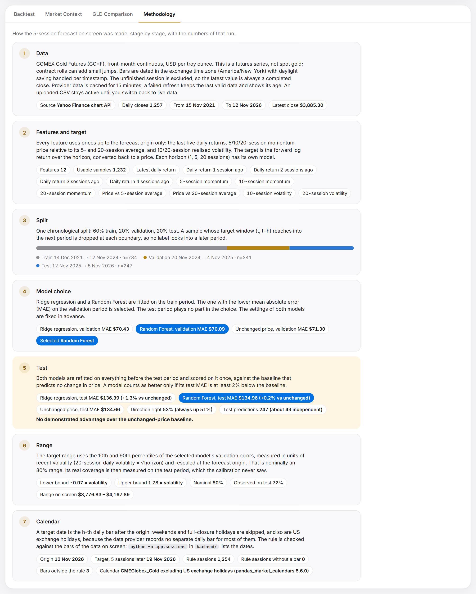
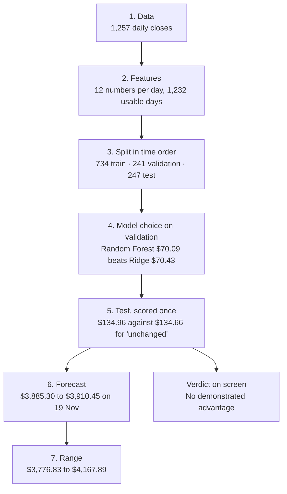
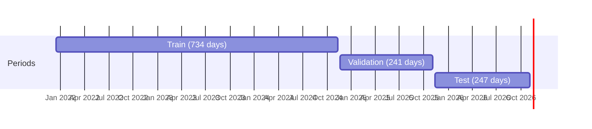

# How one forecast is made

This page follows a single real forecast from the first price to the final range: the **5-session forecast** made on 13 Nov 2026 from prices through 12 Nov 2026. Every number here came out of the app. Start it, pick 5 sessions, run the forecast and open the **Methodology** tab to see the same stages with today's numbers.

<picture>
  <source media="(prefers-color-scheme: dark)" srcset="screenshots/walkthrough-dark.png">
  
</picture>

Two terms used throughout:

- **Session**: one trading day of the exchange. "5 sessions ahead" means the fifth trading day from now, not five calendar days.
- **Average miss (MAE)**: mean absolute error, the average distance between a forecast and the price that followed, in US dollars per troy ounce.

## The whole path



## 1. Data

The app asks Yahoo Finance for five years of daily bars of `GC=F`, the front-month COMEX gold futures contract, priced in US dollars per troy ounce.

| | |
| --- | --- |
| Closes received | 1,257 |
| First and last | 15 Nov 2021 and 12 Nov 2026 |
| Latest close, the **forecast origin** | **$3,885.30** on Thursday 12 Nov 2026 |

The last six closes, which the features below are built from:

| 5 Nov | 6 Nov | 9 Nov | 10 Nov | 11 Nov | 12 Nov |
| ---: | ---: | ---: | ---: | ---: | ---: |
| $4,113.50 | $4,074.90 | $4,114.50 | $4,030.20 | $4,000.50 | $3,885.30 |

Three rules keep the data honest ([`data.py`](../backend/app/data.py)):

- **Only finished sessions.** If the exchange is still trading, today's bar is dropped. Its price is shown on screen but never modelled.
- **Dates in the exchange's time zone.** Each bar is dated in `America/New_York`, with daylight saving handled per bar.
- **Nothing is invented.** A series with a zero or negative price, a future date or a one-day move above 30% is rejected. A row without a price is dropped and reported, never filled in. If the provider fails, the last valid data stays and its age is shown.

## 2. Features and target

For every day, the app computes 12 numbers from prices **up to and including that day**, never after it ([`features.py`](../backend/app/features.py)). These are their values at the origin, 12 Nov 2026:

| Group | Feature | Value on 12 Nov 2026 |
| --- | --- | ---: |
| Recent returns | Latest daily return | −2.92% |
| | 1 session ago | −0.74% |
| | 2 sessions ago | −2.07% |
| | 3 sessions ago | +0.97% |
| | 4 sessions ago | −0.94% |
| Momentum | Over 5 sessions | −5.71% |
| | Over 10 sessions | −3.69% |
| | Over 20 sessions | −7.07% |
| Distance from average | Price against its 5-session average | −3.38% |
| | Price against its 20-session average | −4.07% |
| Volatility | Daily, over 10 sessions | 2.13% |
| | Daily, over 20 sessions | 1.60% |

You can check the first one by hand: $3,885.30 ÷ $4,000.50 = 0.9712, and the natural logarithm of that is −0.0292. Returns are measured as logarithms so they add up over several days.

The **target** is what the models learn to predict: the log return over the next 5 sessions.

A day is usable when it has all 12 features and a known outcome. The first 20 days have no 20-session history, and the last 5 have no outcome yet:

> 1,257 closes − 20 − 5 = **1,232 usable days**

## 3. Split

The 1,232 days are cut into three periods **in time order**. Nothing is shuffled, because a model must never learn from days that come after the ones it is tested on.



| Period | Dates | Days | Used for |
| --- | --- | ---: | --- |
| Train | 14 Dec 2021 to 12 Nov 2024 | 734 | Fitting both models |
| Validation | 20 Nov 2024 to 4 Nov 2025 | 241 | Choosing the model and sizing the range |
| Test | 12 Nov 2025 to 5 Nov 2026 | 247 | The grade. Scored once, at the end |

That adds up to 1,222, not 1,232. Ten days were **dropped at the two boundaries**: a day's outcome lies 5 sessions later, so the last 5 days of a period have outcomes inside the next one. Keeping them would let the next period leak backwards. The gaps in the diagram are those days ([`split_positions` in `model.py`](../backend/app/model.py)).

## 4. Model choice

Two models are fitted on the train period:

- **Ridge regression**: a straight-line model, with inputs put on a common scale and a strong pull towards zero (`alpha=100`).
- **Random Forest**: 200 shallow decision trees (depth 4, at least 20 days per leaf), averaged.

Their settings are fixed in advance. Each then forecasts the validation period, and the one with the lower average miss is chosen:

| Contender | Average miss on validation |
| --- | ---: |
| Ridge regression | $70.43 |
| **Random Forest** | **$70.09** |
| Price unchanged (for reference; cannot be chosen) | $71.30 |

**Random Forest is selected**, by 34 cents. The test period plays no part in this choice, and a backend test checks that changing test prices leaves the choice untouched.

## 5. Test

Both models are fitted again, now on everything before the test period, and forecast each of its 247 days. This is the only time the test period is used.

| Contender | Average miss on test | Against "unchanged" |
| --- | ---: | ---: |
| Ridge regression | $136.39 | 1.3% worse |
| Random Forest (selected) | $134.96 | 0.2% worse |
| **Price unchanged** | **$134.66** | |

The rule for the verdict is written in the code before any result is known: a model has an advantage only if its miss is **at least 2% below** the baseline's. Here that would mean $131.97 or less. Random Forest scored $134.96.

Two more readings of the same test:

- **Direction.** Random Forest called up-or-down correctly 53% of the time. Saying "up" every time would have scored 51%.
- **How much evidence this is.** The 247 forecasts overlap, since each one covers 5 sessions. Only about 247 ÷ 5 = 49 are independent. A 30-cent difference over 49 independent forecasts is noise.

So the screen reads: **No demonstrated advantage over the unchanged-price baseline.** That sentence is computed from these numbers. If a model ever clears the 2% bar, the app will say "Beat the unchanged baseline" instead.

## 6. The forecast

For the forecast itself, the selected model is fitted one last time on all 1,232 days and given the 12 feature values of 12 Nov 2026 from stage 2.

| | |
| --- | --- |
| Predicted log return over 5 sessions | +0.006451 |
| Forecast price | $3,885.30 × e^0.006451 = **$3,910.45** |
| Change | +0.65% |
| Target session | **19 Nov 2026** |

The target date comes from the exchange calendar, not from adding five days ([`sessions.py`](../backend/app/sessions.py)). The five sessions after Thursday 12 Nov are 13, 16, 17, 18 and 19 Nov; the weekend is skipped. Over 20 sessions the same rule skips Thanksgiving and lands on 11 Dec.

The calendar rule is itself checked against the data: of the 1,254 sessions the rule expects in these five years, every one has a bar, and 3 bars fall on days the rule does not expect.

## 7. The range

A single number hides how unsure the forecast is, so each one comes with a range that should hold 80% of the time.

**Step 1: measure the model's past errors in units of volatility.** On the validation period, each error is divided by how much gold was expected to move at that moment: the 20-session daily volatility times √5. The 10th and 90th percentiles of those scaled errors are:

> −0.973 and +1.785

**Step 2: scale back with today's volatility.** On 12 Nov 2026 the daily volatility was 1.598%, so the expected 5-session move is 1.598% × √5 = 3.573%.

| | Calculation | Result |
| --- | --- | ---: |
| Lower bound | $3,885.30 × e^(0.006451 − 0.973 × 0.03573) | **$3,776.83** |
| Upper bound | $3,885.30 × e^(0.006451 + 1.785 × 0.03573) | **$4,167.89** |

The range is lopsided: it reaches 7.3% up and 2.8% down. The validation errors were lopsided in the same way, because gold rose through that year by more than the model expected. The method keeps that shape rather than forcing a symmetric range.

**Step 3: check it.** A range that is supposed to hold 80% of the time is then counted on the test period, which the range was never fitted to. It held **72%** of the time. The app prints both numbers side by side: "nominal 80% · observed 72% on test".

Because the range follows volatility, it widens in turbulent markets and narrows in calm ones.

## The other two horizons

Each horizon has its own model, its own split and its own grade. Same data, same day:

| | 1 session | 5 sessions | 20 sessions |
| --- | ---: | ---: | ---: |
| Usable days | 1,236 | 1,232 | 1,217 |
| Train / validation / test days | 740 / 246 / 248 | 734 / 241 / 247 | 710 / 223 / 244 |
| Validation miss: Ridge / Forest / unchanged | $32.96 / $33.10 / $33.07 | $70.43 / $70.09 / $71.30 | $130.37 / $133.86 / $146.98 |
| Model picked | Ridge | Random Forest | Ridge |
| Test miss: Ridge / Forest / unchanged | $57.67 / $57.88 / $57.43 | $136.39 / $134.96 / $134.66 | $283.80 / $288.16 / $270.39 |
| Picked model against "unchanged" | 0.4% worse | 0.2% worse | 5.0% worse |
| Direction right: picked / "always up" | 50% / 51% | 53% / 51% | 47% / 45% |
| Independent test forecasts, about | 248 | 49 | 12 |
| Forecast for | 13 Nov: $3,889.69 | 19 Nov: $3,910.45 | 11 Dec: $3,955.85 |
| Range | $3,809.53 to $3,984.12 | $3,776.83 to $4,167.89 | $3,842.30 to $4,572.88 |
| Range held on test (should be 80%) | 83% | 72% | 50% |
| Verdict | No advantage | No advantage | No advantage |

The 20-session column is the instructive one. On validation the two models beat the baseline by about 11% and 9%. On test they lost to it by about 5% and 7%. Had the project stopped at validation, it would have reported a model that works.

## Where each stage lives

| Stage | Code | Tested by |
| --- | --- | --- |
| 1. Data | [`backend/app/data.py`](../backend/app/data.py): `parse_yahoo_chart`, `validate_prices`, `DataStore` | [`test_validation.py`](../backend/tests/test_validation.py), [`test_api.py`](../backend/tests/test_api.py) |
| 2. Features and target | [`backend/app/features.py`](../backend/app/features.py): `build_features`, `build_target` | [`test_model.py`](../backend/tests/test_model.py): features use past prices only |
| 3. Split | [`backend/app/model.py`](../backend/app/model.py): `split_positions` | `test_model.py`: no label reaches into a later period |
| 4 and 5. Model choice and test | `model.py`: `run_prediction`, parts 1 and 2 | `test_model.py`: the choice does not depend on test prices |
| 6. Forecast and target date | `model.py`: `run_prediction`, part 3; [`sessions.py`](../backend/app/sessions.py): `next_sessions` | [`test_sessions.py`](../backend/tests/test_sessions.py) |
| 7. Range | `model.py`: the `z` quantiles and `interval` | `test_model.py`: the range does not depend on test prices |
| The screen | [`frontend/src/components/Methodology.tsx`](../frontend/src/components/Methodology.tsx) | [`e2e/run.mjs`](../e2e/run.mjs): the stages match the API values |

## See it with today's numbers

```bash
# with the app running on port 8742
curl "http://localhost:8742/api/predict?horizon=5"
```

The reply holds everything on this page: `splits`, `selection.validation_mae`, `test.methods`, `forecast.price`, `forecast.interval` and `calendar.check`. The numbers will differ from the ones above as soon as a new session closes.
